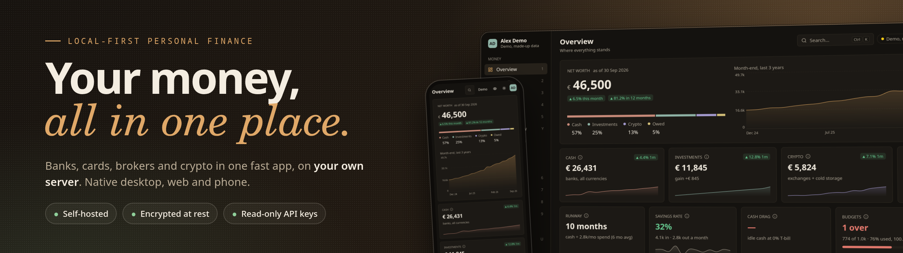

<p align="center"></p>

<p align="center"><sub>Rust · GPUI · SQLite · coded primarily with <a href="https://www.anthropic.com/claude">Claude Opus 5.5</a> via <a href="https://claude.com/claude-code">Claude Code</a>, with <a href="https://x.ai/grok">Grok</a></sub></p>

# Anser

A private, local-first personal-finance app. It brings bank accounts and
cards (N26, HSBC, Revolut, Mox, plus any bank through a format definition),
brokers (Interactive Brokers, HSBC FlexInvest) and crypto (Binance, OKX, a
Trezor cold wallet) into one net-worth view in your base currency, with
spending, budgets, subscriptions, travel, cash flow and investment pages on
top.

It runs on a server you own (any Linux box: a Raspberry Pi, a home server, a
small VPS) and on your own devices:

- **`anser-server`**, the server: one SQLite database per user, ingest of
  exported statements, read-only API syncs, the valuation model, an HTTP API
  on `127.0.0.1:8787` published to the tailnet with `tailscale serve`. The
  small headless build, for a server like a Pi: no GUI libraries needed.
- **`anser`**, the native app (GPUI): opens instantly from a
  local replica, works offline, syncs in the background. It includes the
  whole server: `anser server <cmd>` is `anser-server <cmd>`, so one binary
  is enough on a desktop.
- **The web app**: the same pages compiled to WebAssembly and served by
  `anser-server`, installable on a phone as a PWA.

The only outbound calls are read-only: exchange and broker APIs, IBKR's Flex
Web Service, frankfurter.dev for FX and Yahoo Finance for closes. Nothing is
uploaded anywhere else.

## Install

On Linux, the latest GitHub Release:

```bash
curl -fsSL https://raw.githubusercontent.com/lucianosrp/anser/main/install.sh | sh
```

That puts `anser` in `~/.local/bin` (x86_64) and a launcher entry: one
binary, with the server built in. No sudo. Checksums are verified against
`SHA256SUMS`. The app can talk to a server elsewhere (your tailnet), or run
one itself on this machine (`anser server serve`, data in
`~/.local/share/finance`).

For a box without a screen (a Raspberry Pi, a home server, a VPS), `--server`
installs the small headless `anser-server` instead; it is the default on
aarch64. Same commands as `anser server`.

```bash
curl -fsSL https://raw.githubusercontent.com/lucianosrp/anser/main/install.sh | sh -s -- --server   # anser-server (x86_64 or aarch64)
FINANCE_VERSION=v0.1.0 sh install.sh --server     # a specific tag
```

`INSTALL_DIR` overrides `~/.local/bin`. The server binary is not started for
you; next steps are in [DEPLOY.md](DEPLOY.md). To build from this checkout
instead, see [Getting started](#getting-started).

## Trademarks

The names and logos of banks, brokers, exchanges, coins, merchants and
products shown in the app belong to their owners. This project is not
affiliated with, endorsed or sponsored by any of them. A logo only identifies
where a user's own data comes from. The logos are SVG paths from
[Simple Icons](https://simpleicons.org) (CC0); that license covers the paths
only, not any trademark rights (see
[THIRD_PARTY_NOTICES.md](THIRD_PARTY_NOTICES.md)). If you are a brand owner and
want a logo removed, open an issue and it goes. Logos can be switched off in
Settings (`logos = false` in `theme.toml`).

## Disclaimer

This is a personal record-keeping tool. It is not financial, tax, investment
or legal advice. Check its numbers against your statements. It is provided
"as is", without warranty of any kind (see [LICENSE](LICENSE)).

It is read-only with respect to money: it never places trades, moves funds or
pays anyone. API keys are tested by the server and a key that can trade,
withdraw or transfer is refused. You are responsible for your API keys and
your data.

## Architecture

Everything is one Cargo workspace in `desktop/`:

| Crate | Package | What |
|---|---|---|
| `engine/` | `finance-engine` | The store (SQLite schema and migrations), file parsers and ingest, categorization, valuation views, the export bundle, fetchers, encrypted archives, the demo household. UI-free, HTTP-free |
| `server/` | `finance-server` (binary `anser-server`) | HTTP API, background sync, accounts and pairing, the secrets store, backups, push, hosting the web app, the CLI (`finance_server::cli`, also `anser server`), the `/mcp` endpoint and its keys |
| `core/` | `finance-core` | The client side, UI-free: replica cache and sync, ledger, search, budgets, recurring payments, travel, the encrypted local copy |
| `app/` | `anser` | The GPUI pages (desktop, and the web app's source); links `finance-server` for `anser server <cmd>` |
| `web/` | `finance-web` | `app/` built for `wasm32-unknown-unknown` on GPUI's web backend |
| `shots/` | `finance-shots` | Optional: README screenshots of the demo through headless Chrome |

```
anser-server (server)  ── ingest, rules, syncs, valuation; one finance.db per user
  ├─ GET /api/export.json   every view's computed numbers (the bundle)
  ├─ GET /api/ledger.json   every ledger row (the web app)
  └─ GET /api/db.sqlite     a consistent snapshot of the user's finance.db
        │  background sync over the tailnet
        ▼
anser  ── local replica (optionally encrypted), works offline
web app          ── the same pages in a browser tab, served at /
```

Raw rows (transactions, card purchases, crypto events, trades) come from the
database snapshot; anything that needs the valuation model (net worth,
investments, costs) comes from the bundle, so the clients never
reimplement it. Details: [desktop/README.md](desktop/README.md) (the app,
every page) and [desktop/server/README.md](desktop/server/README.md) (the
server, its API and CLI).

## Data sources and keys

<!-- sources:begin -->
| Source | Kind | What you give it |
|---|---|---|
| N26 | bank account | exported file: CSV |
| HSBC credit card | credit card | exported file: CSV or monthly PDF |
| HSBC | bank account | exported file: CSV |
| Mox | bank account | exported file: monthly PDF |
| HSBC unit trust (SMS) | fund orders | exported file: XML backup of text messages |
| Revolut (GBP, legacy) | bank account | exported file: CSV (old layout) |
| Revolut | bank account | exported file: CSV, Excel or PDF |
| Revolut (BTC ledger) | crypto wallet | exported file: CSV (old BTC ledger) |
| Trezor (cold wallet) | crypto wallet | exported file: CSV |
| Monzo | bank account | exported file: CSV |
| Barclays | bank account | exported file: CSV |
| Binance | exchange | signed read-only API: key + secret |
| OKX | exchange | signed read-only API: key + secret + passphrase |
| Interactive Brokers | broker | Flex Web Service (a reporting token, cannot trade): token + query id |
<!-- sources:end -->

Anything else with a table-shaped export: a format definition (TOML), from
the Upload page's *Map columns…*, see [desktop/docs/formats.md](desktop/docs/formats.md).
Files need no setup: drop them on the Upload page or into `transactions/`.
Step by step, per source: [desktop/README.md](desktop/README.md#supported-sources).
(Generated from the catalog; `FINANCE_BLESS_DOCS=1 cargo test -p finance-engine --test catalog_docs` rewrites it.)

Keys are entered in the app (Settings, Data sources), tested by the server
(a key that can trade, withdraw or transfer is refused) and stored in an
encrypted secrets store; `.env` (see `.env.example`) still works as a
fallback. Ingest is idempotent: files are recognized by their content, rows
deduped by a natural key, so re-exports and overlapping files add nothing.

## Valuation

- **History**: a monthly balance sheet from reported bank balances, crypto
  at month-end closes and investments at cost or marked to a proxy, all in
  the base currency at monthly FX.
- **Now**: live exchange balances and tickers, broker cash and positions;
  per holding the best mark wins: broker mark > index-proxy estimate > cost
  basis. Money owed to you (deposits held, a partner's share of bills)
  counts in net worth.
- **Offline**, everything falls back to the last snapshot with a stale
  badge. Pages never fail on a network error.

## Household, security, demo

- **Several users on one server.** Each account has its own data tree,
  database, sources and keys; nobody reads anyone else's data through the
  app or the API, admins included. Devices join with a one-time pairing
  code; invites make new accounts.
- **Encryption.** API keys in an encrypted store on the server; nightly
  backups as encrypted `.finance` archives (age, sealed to a key only your
  laptop holds); an optional encrypted local copy on the desktop.
- **Just try it.** A made-up household (generated, deterministic, no real
  data) that every page can show: *Just try it* in the app, or `?demo=1` in
  the browser. All screenshots come from it.

## Getting started

From a checkout (or skip this and [install a release](#install)):

You need a recent stable Rust (1.92 or newer) and, on Linux, the system
packages GPUI and the keyring build against (Debian/Ubuntu names):

```bash
sudo apt-get install -y --no-install-recommends \
  pkg-config libxkbcommon-dev libxkbcommon-x11-dev libwayland-dev \
  libvulkan-dev libfontconfig-dev libfreetype-dev libx11-xcb-dev \
  libxcb1-dev libxcb-xkb-dev libasound2-dev libdbus-1-dev libssl-dev \
  libzstd-dev poppler-utils
```

`poppler-utils` is for reading PDF statements (it is also what the server
needs at run time). The GUI libraries matter only for `anser`.

```bash
cd desktop
cargo build --release -p finance-server            # the server only (fast; no GPUI)
FINANCE_HOME=~/.local/share/finance target/release/anser-server serve   # http://127.0.0.1:8787 (the default home outside a checkout)
cargo run --release -p finance-desktop              # the desktop app (first build ~2 min)
scripts/install.sh                                  # or install it for this user (launcher + icon)
```

From a checkout, `FINANCE_HOME` defaults to the repo root (`data/`,
`transactions/` and `.env` there, all gitignored). On first start the app
opens a setup wizard: where the data lives, your account, currency, sources.

The web app: `rustup target add wasm32-unknown-unknown`, the matching
`wasm-bindgen-cli`, then `desktop/scripts/build-web.sh --install URL` (or the
Doctor page's *Install web app on the server*).

## Commands (`anser-server`, or `anser server`)

The desktop app includes the server: every command below also runs as
`anser server <cmd>` (`anser server serve`, `anser server stats`, …).
`anser-server` is the same CLI without the GUI, for a headless server.

```bash
anser-server serve [--bind HOST:PORT]     # the API and the web app
anser-server --version                    # the build's version (anser --version too)
anser-server ingest | categorize [--reset --yes-replace-rules] | stats | report [--from --to] | txns | override
anser-server sync | fetch-crypto [--exchange binance|okx|ibkr|all] | fetch-fx | refresh-prices
anser-server backup [--keep N]            # online db copy -> data/backups/ (+ an encrypted archive)
anser-server export | import | verify     # encrypted .finance archives
anser-server pair | user … | auth … | secrets …   # devices, household, auth mode, keys
anser-server push [--remote URL] | install-webapp --dir DIR --server URL
```

The full table, with every flag and environment variable:
[desktop/server/README.md](desktop/server/README.md#commands).

## Tests

```bash
cd desktop
cargo test --workspace                                             # everything, data-free
FINANCE_PARITY_DIR=$PWD/../data/parity cargo test --workspace      # + the optional private golden tests
RUSTC_BOOTSTRAP=wasm_thread cargo check -p finance-web --target wasm32-unknown-unknown
```

Tests that need personal data read `$FINANCE_PARITY_DIR` (a gitignored
snapshot: a production database, its exports, frozen goldens) and skip cleanly
without it. They pin one install's output byte for byte (the export bundle,
what the app computes from the replica) across every change. Everything
else runs on synthetic data. See
[desktop/server/README.md](desktop/server/README.md) for the list.

## Screenshots

`cargo run -p finance-shots --release` (in `desktop/`) builds the web app
and the server, starts them on the demo household with a pinned date, and
captures every page through headless Chrome: same commit, same pixels.
`desktop/shots/hero.html` lays out the banner above.
Details: [desktop/README.md](desktop/README.md#screenshots).

## Deploy

`scripts/deploy.sh` ships committed `main` to your server (the ssh
target comes from `FINANCE_HOST` or the gitignored `scripts/deploy.local`).
A `v*` tag on HEAD installs `anser-server` and the web app from the GitHub
Release; otherwise it builds on the server (`--build` forces that). Then it
backs the database up, restarts the systemd user unit and checks `/healthz`.
A `v*` tag attaches linux `anser-server` (x86_64 and aarch64), `anser`
and the web app to a GitHub Release ([DEPLOY.md](DEPLOY.md#releases)).
Units, household setup, backups and restores: [DEPLOY.md](DEPLOY.md).

## MCP

An AI assistant can read your finances through MCP: eight read-only tools
(`summary` to start, then `trend`, `breakdown`, `transactions`, `recurring`,
`holdings`, `performance`, `activity`), the same data and the same numbers as
the pages. Nothing in it writes, places a trade or moves money.

- **Over HTTP**, from Claude Code, Claude Desktop, Cursor or Codex: the
  server's `/mcp` endpoint, off until you switch it on, opened only by an
  MCP key (a token that works on `/mcp` and nowhere else), and published like
  everything else here: on your tailnet only. Setup:
  [DEPLOY.md](DEPLOY.md#mcp-for-an-assistant).
- **Over stdio**: `anser-server mcp [--user NAME|ID]`, for a client that
  starts it on the server's own shell. No key, no switch.

The tools, the key API and the checks are in
[desktop/server/README.md](desktop/server/README.md#mcp).

## Privacy

`transactions/` (statements), `data/` (databases, backups), `.env` (keys)
and `knowledge/*` (notes about your finances) are gitignored and
never committed. Every API credential is read-only; nothing in this app can
place a trade or move money. The sync endpoints serve the whole database, so
the server stays on the tailnet, never on the public internet.

## Built with

Written in Rust on [GPUI](https://gpui.rs) and
[gpui-kit](https://gpui-kit.com), with SQLite, age and XChaCha20-Poly1305.
The project has been coded primarily by
[Claude Opus 5.5](https://www.anthropic.com/claude) (Anthropic) through
[Claude Code](https://claude.com/claude-code), with
[Grok](https://x.ai/grok) (xAI) building parts of it (the first-load
warm-up, the Mox statement parser, the release workflow), directed and
reviewed by its owner.

## The name

*Anser* is Latin for goose. Rome kept sacred geese on the Capitol by the
temple of Juno Moneta, and by tradition their honking woke the city to a
night attack in 390 BC. Rome's mint later stood in that temple, which gave
us the words *money* and *mint*. The app does what the geese did: it watches
over the money and raises the alarm, and never touches it.

## License

[MIT](LICENSE). Third-party components keep their own licenses:
[THIRD_PARTY_NOTICES.md](THIRD_PARTY_NOTICES.md).
