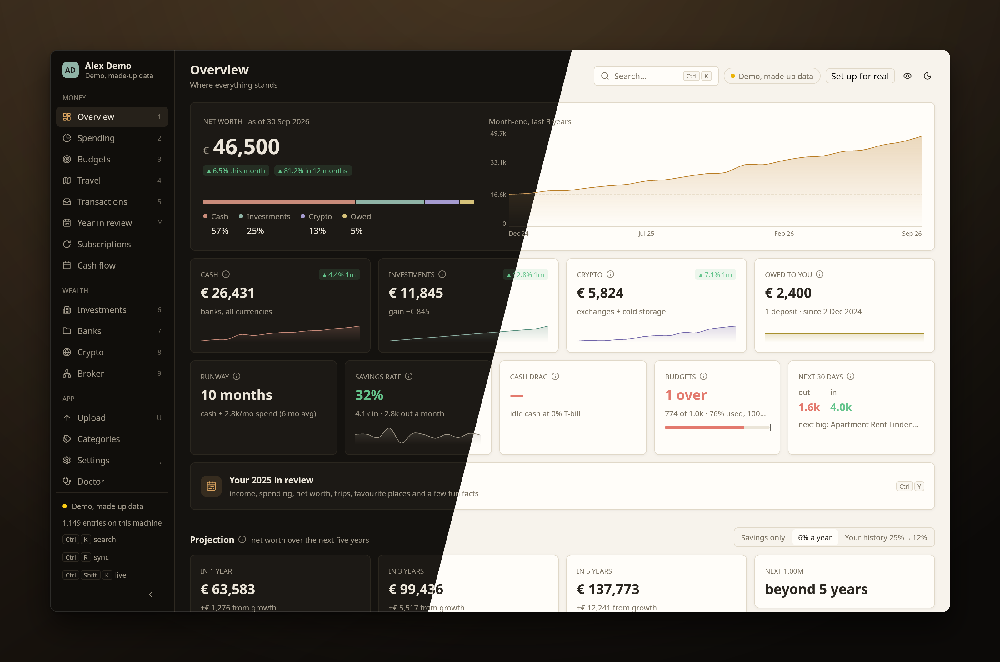
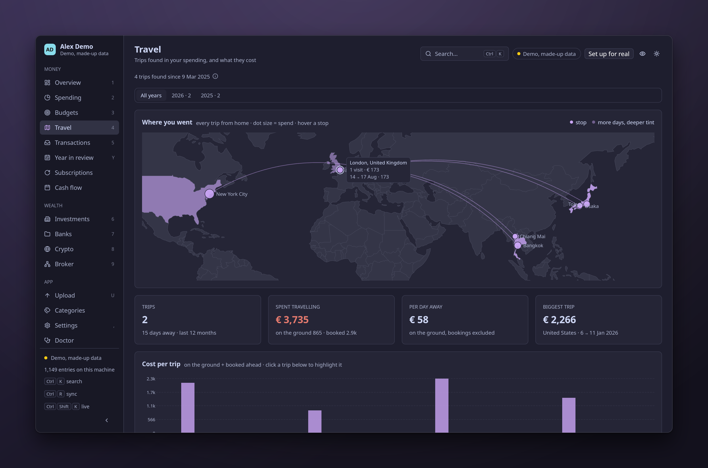
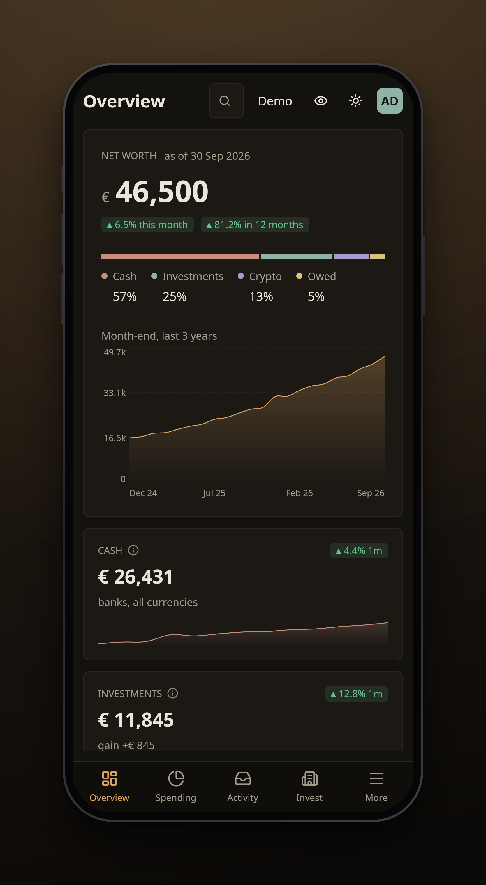

# anser

A native, local-first client for the finance data, built in Rust with
[GPUI](https://gpui.rs) and [gpui-kit](https://gpui-kit.com). It opens instantly
from a local replica, works offline, and syncs from your server in the background.

```bash
cd desktop
cargo run -p finance-desktop --release
```

The first build takes about 1–2 minutes (GPUI). Rebuilds take seconds.



<p>


</p>

(The made-up demo household; see *Screenshots* for how these are made.)

## Install

```bash
desktop/scripts/install.sh            # build (release) + install for this user
desktop/scripts/install.sh --uninstall
```

The script links `~/.local/bin/anser` to the release build, so a rebuild
updates the installed app. It also adds a launcher entry
(`~/.local/share/applications/anser.desktop`) and an icon
(`~/.local/share/icons/hicolor/scalable/apps/anser.svg`). The icon is a
goose quill writing a rising line, engraved in the current accent on a dark
tile of the same hue (anser is Latin for goose). Each time
the theme is applied (a matugen palette change, an accent change in Settings),
the app re-colors the installed icon. `anser --icon PATH` writes it
by hand.

## How it fits

```
anser-server on the server (source of truth: ingest, rules, syncs, valuation)
  ├─ GET /api/export.json   every view's computed numbers  (engine/src/export.rs)
  └─ GET /api/db.sqlite     consistent snapshot of finance.db
        │  background sync: on launch when older than 15 min, every 30 min, Ctrl+R
        ▼
~/.local/share/finance-desktop/profiles/<account>/{export.json, finance.db}   (atomic replace)
        ▼
anser  ──  core/  (finance-core: cache, sync, ledger, search; UI-free)
                 └─  app/   (GPUI views)
```

- **Raw rows**, such as transactions, card purchases, crypto events and IBKR
  trades, come from the SQLite snapshot. 6.4k entries load in about 12 ms.
- **Anything that needs the valuation model** (net worth, investments, costs,
  spending trend) comes from the bundle. The client never recomputes it.
- `finance-core` has no UI dependency. The sync contract is the seam: the
  client doesn't care what produces it.
- The server (`engine/` + `server/`, binary `anser-server`) produces the
  contract and serves `127.0.0.1:8787` by default. See
  [server/README.md](server/README.md).

## Search everything

Press **Ctrl+K** anywhere to open a palette that searches pages, actions,
themes and every transaction. Typing a theme's name (or "theme", "dark",
"light") lists the palettes and modes; arrowing over one previews it live,
Enter keeps it (same as Settings), Esc puts the saved theme back. The **Transactions** page (Ctrl+5, or Ctrl+F) has the same
search over a virtualized table. Fuzzy text search takes about 4 ms; filters
take about 0.2 ms.

| Query | Means |
|---|---|
| `coffee` | fuzzy match on description, category, source, date, amount |
| `12345` | numbers match exactly (no fuzzy noise) |
| `cat:dining` | category contains "dining" |
| `cat:dining,groceries` | any of them: a comma means "or" (works for every `key:`) |
| `cat:"office (reimbursed)"` | quotes keep spaces |
| `src:card` | source or kind contains "card" (`bank`, `crypto`, `broker`, `hsbc`, `n26`, …) |
| `acct:hsbc_card`  `acct:"n26/savings pocket"`  `acct:"main account"` | one account: `source/account`, the bare source, or the account name. `acct:hsbc` is the bank account, not the card |
| `merchant:sushiro` (or `m:`) | the merchant: its words start with this (`drill::merchant_text`, acquirer prefixes like `BBMSL*` dropped) |
| `ccy:eur` | native currency |
| `trip:2026-03-14` | the rows of the trip that started that day (abroad and booked ahead) |
| `-cat:rent`  `-acct:…`  `-ccy:eur` | a leading `-` excludes |
| `>500`  `<20` | absolute amount in your base currency above / below |
| `amt:100..500` | absolute amount in your base currency between, inclusive (`amt:100..`, `amt:..500`) |
| `2026-09` | date prefix (a year, a month or a day) |
| `2026-01..2026-06` | date range, inclusive at both ends (`2026-03..` since, `..2025` until, days work too) |
| `in`  `out` | money in / money out only |

Combine them, e.g. `cat:dining 2026-09 >100`. Every term must hold, so
repeated tokens of one kind still mean "and" (`cat:dining cat:coffee` is
"Dining: coffee"), as they always did. The query is parsed by
`finance_core::filter`, the filter model every page shares.

## Filters

The query is the filter. The filter bar under the search box shows each
term as a chip and edits the query text, so typing and clicking can never
disagree, and your own spelling and order survive an edit
(`finance_core::filter::Filter` keeps the terms in order).
- **Chips.** One per term: *Category: Dining, Groceries*, *Not account: HSBC*,
  *Date: Last 3 months*, *Amount > 500*, *Money out*. × clears one, *Clear
  all* clears every filter but keeps the free text. Clicking a category,
  account, source or currency chip flips it between "only" and "not".
- **Adding.** One button per dimension. *Account* (single accounts plus whole
  kinds and sources), *Category*, *Merchant*, *Currency* and *Trip* open a
  searchable picker. Each option shows how many rows it has among those the
  rest of the filter keeps. Enter or a click toggles an option and the picker
  stays open for more; Esc closes it. *Date* has presets (this month, last
  month, last 3 / 6 / 12 months, this year, last year) and a custom range.
  *Amount* has presets and a custom field (`>300`, `<50`, `100..500`). *In /
  out* picks a direction.
- **Saved filters.** *Saved* lists them for one-click recall. *Save this
  filter…* names the current one; the same dialog deletes. They live in
  `filters.toml` next to `theme.toml` (`$FINANCE_DESKTOP_FILTERS` overrides):

  ```toml
  [[filter]]
  name = "HK dining"
  query = "cat:dining ccy:hkd"
  ```
- **Summary strip** (Transactions): the rows, money in, money out and net of
  the matches (your share, HK$), a sparkline of the last 24 months (out, or
  in when the set is mostly income), and *Plot*, the Ctrl+Enter plot.
- **Right-click a row** in the table: open its detail, its merchant's or
  category's deep dive, or narrow the search to "only" or "hide" that
  merchant or category.

### Deep dives

A merchant or a category opens in a dialog (`finance_core::dive`; Esc closes).
- **Merchant**: spent (and refunds), visits per month and the median gap
  between them, the average and median ticket, the price trend (the median
  ticket over the last 6 months of visits against the 6 before, when each has
  3+ visits), first and last seen, spend per month, the median ticket per
  quarter, the categories it's filed under, the accounts that paid, and the
  latest rows.
- **Category**: this month (against its budget when one is set), the last 12
  months and their monthly average, its share of all spending, 24 months of
  bars (red above the budget), the top merchants, and the latest rows. A
  category that is mostly money in (Salary) shows what came in.
- Both end with *Show all in Transactions* (`merchant:` / `cat:`) and *Plot*.
  A row opens its detail; a merchant or category inside opens its own dive.
- **Where they open:** Spending's categories and the merchant name in
  *Biggest this month*, the detail sheet (*Merchant deep dive*, and the
  category), the table's right-click menu, and each other.

### Filters on other pages

- **Spending** has its own filter strip: keep only or exclude accounts,
  exclude categories (Rent, Office (reimbursed)), keep categories or
  currencies (`-ccy:eur,gbp` is "HK only"). With a filter on, a banner says
  so and every tile, chart, the Sankey, the categories, *Biggest*, fixed vs
  variable and the tables are worked out from the ledger rows the filter keeps
  (`filter::month_figures`), so totals can differ a little from the server's
  unfiltered numbers. Fixed is a fixed category or a merchant the server calls
  fixed; Invested is bank and card money sent to investments.
- **Subscriptions**: one account (dropdown) and a status (all, active, worth a
  look, ended). The tiles and chart follow the account.
- **Travel**: a year switcher. The map, tiles, chart and cards show that
  year's trips. An open trip has *Show these rows in Transactions* (`trip:`).

## Keys

| Key | Action |
|---|---|
| Ctrl+K | search everything / command palette |
| Ctrl+1 … Ctrl+9 | Overview, Spending, Budgets, Travel, Transactions, Investments, Banks, Crypto, Broker |
| Ctrl+Y | Year in review |
| Ctrl+U | Upload (dropping files opens it too) |
| Ctrl+, | Settings |
| Ctrl+H (or the eye in the header) | privacy mode: mask every amount (saved) |
| Ctrl+K, then the name (or the sidebar) | Subscriptions, Cash flow (no digit key) |
| Ctrl+= / Ctrl+− / Ctrl+0, Ctrl+scroll | zoom in / out / reset (60–200%, saved) |
| Ctrl+Enter | in the search box or the Ctrl+K palette: plot every match |
| Ctrl+F | focus the transactions search |
| Ctrl+R | sync now |
| Ctrl+O / Ctrl+I, mouse back / forward | jump list: back / forward through where you've been (not while typing in a field) |
| Ctrl+B (or the chevron at the sidebar's bottom) | collapse the sidebar to an icon rail, or expand it (saved) |
| Ctrl+T | toggle dark / light |
| Ctrl+Q | quit |
| ← → or [ ] | Spending: previous / next month. Year in review: previous / next year |
| Enter (or double-click) | Transactions: open the selected row in a detail sheet |
| Right-click a row | Transactions: details, merchant or category deep dive, only / hide that merchant or category |
| Esc | close the detail sheet |

## Drill-down

- **Spending** shows one month at a time. It opens on the last completed
  month, and ← → / [ ] or the arrow buttons move it. The cards, the categories
  and *Biggest this month* follow the selection, and the 12-month chart
  highlights it. Click a category for its deep dive, a merchant's name in
  *Biggest* for the merchant's, or anywhere else on a row for its detail. *Biggest* lists bank and card outflows that
  are spending: transfers, investments, card bills, FX, partner and deposit
  categories are skipped, and shared rows count your share only
  (`finance_core::drill`).
  When some rows are in a home category (*Mark as* on a transaction), a
  **Home** tab appears next to *This month*: the cost of living (housing,
  groceries, other essentials) as last month and 12-month average with its
  share of income, a stacked 12-month chart, and the home bills with
  *missing* and *high* flags, all worked out from the ledger
  (`finance_core::home`). `FINANCE_DESKTOP_SPEND_TAB=home` opens it.
  **Settings › Home** (`FINANCE_DESKTOP_SETTINGS_TAB=home`) keeps the home
  setup (rent or none, monthly rent, currency, the lease's dates, the landlord
  text, and one-off costs such as the deposit; the `home` user setting). With
  it, the Home tab adds a **Lease** card (days left, a renewal reminder from
  60 days before the end, rent changes seen in the Rent rows, the setup's
  rent against the last paid) and a **Deposit** card (held or returned), the
  rent bill expects the setup's amount, and the landlord text becomes a rule
  to Rent. A deposit's *returned on* date also closes it in *Owed to you*.
  In **mortgage** mode (loan amount, yearly rate, term, start, optional payment
  day, lender text, home value, overpayments and rate changes; the maths is
  `finance_core::mortgage`) the Lease and Deposit cards give way to a
  **Mortgage** card (balance, payment, payoff, interest this year and to date,
  last paid against the schedule), an **Equity** card, the balance over time,
  each payment's interest and principal, and a "pay a little more" what-if.
  `FINANCE_DESKTOP_HOME_DEMO=mortgage` (`?home_demo=mortgage`) swaps in a
  made-up mortgage for screenshots.
  With a mortgage the Overview's net worth includes the home (as entered) and
  the loan's balance, with a **Home** tile; the projection leaves both out. The
  demo server's `FINANCE_DEMO_HOME=mortgage` makes the demo household own, for
  screenshots.
- **Transactions**: Enter or a double-click opens a side sheet with every
  field, plus the same merchant over time: the row count, the total, the
  monthly average and the latest 10 rows. *Merchant deep dive* opens the
  merchant's dive, *Show all in table* searches `merchant:` for it, and the
  category opens the category's dive. Merchants are matched on a key built from the description
  (acquirer prefixes like `BBMSL*` and words with digits are dropped, then
  the first distinctive word is kept), so a chain's branches group together.

The numbers follow the sidebar's top-to-bottom order for the pages that
are used most. Year in review and Upload sit in the sidebar too, with letter
keys, so the numbers stay within 1–9. The sidebar shows each page's key.

## Category icons

Every category gets a Lucide icon (`app/src/category.rs`): Spending's
category bars, the transactions table, the detail sheet, the palette,
Budgets, Year in review and Travel's legend. Matching is by keyword and
case-insensitive. A keyword matches the start of a word ("rent" finds
"Rental", not "Current"). A keyword of 3 letters or less must match the
whole word or its plural ("bus" is not "business"). A keyword with a space
or a dash can match anywhere. Specific rules come first, so finer
categories like "Dining: coffee" or "Transport / taxi" still get a fitting
icon. An unknown name gets a tag icon, and "Other" gets a dashed circle.
An icon picked on the Categories page (the categories table's `icon`, a
Lucide name) wins over the keywords. Only the icons listed in
`category_icons!` are embedded, and those are the ones the picker offers.
The Sankey's labels are painted by the chart, so they stay text only.

## Categories and rules

Categories are the server's data (see the server README, Categories and
rules): what each one means, and the rules that fill them. The app reads
them from the replica (the web app from `/api/ledger.json`) and changes them
through the server.

- **Change category…** in the detail sheet and the table's right-click menu
  (bank and card rows): a searchable list with the icons, "New category…"
  (type a name that isn't there), and a scope. *This row* pins the row (an
  override: no rule moves it; *Use the rules again* drops it). *All like
  this* makes a rule: the pattern starts from the row's merchant (its
  merchant key, else its merchant words), editable; money out or in follows
  the row's sign. The dry run shows how many rows match, what they add up
  to, how many would change, how many are pinned by hand or stay with a
  stronger rule, and up to 20 rows with the rule that decides each now.
  Save makes it your rule at the priority the dry run found.
- **Categories** (sidebar, under Upload) has three tabs. *Categories*: every
  category with its icon (click it for the icon picker), kind, fixed,
  reimbursable and hidden, and in its ⋯ menu the flags the pages read:
  *Paid from anywhere* (places nobody on a trip), *An obligation* (never
  "maybe forgotten") and how recurring it is (by nature, when steady, or
  everyday spending: how much evidence Subscriptions wants); click a name to rename it; merge into another;
  delete into another (or back to Other, which deletes its rules); up and
  down to reorder. Renames, merges and deletes carry the rules, the
  hand-picked rows and the budgets along. *Rules*: every rule in the order
  they apply (your rules, then the starter rules, each by priority), an
  origin badge, an on/off switch, how many rows each decides; the pencil
  edits priority, pattern, category, direction and share in place; *Test*
  takes a description and an amount and says which rule wins and why.
  *Categorize Other*: the uncategorized rows grouped by merchant, the
  biggest first, each with a proposed rule and the reason (your own name,
  the partner, a deposit, the same merchant elsewhere, a monthly charge, a
  word your rules use). Accept makes it your rule; *Pick…* chooses another
  category; *Edit rule…* opens the change-category picker on it. Spending
  ("Where it went") and Transactions link here when some rows are in Other.
- **Starting from zero**: with fewer than 20 rules on, Rules and Categorize
  Other offer the starter set (common merchants into a ready category set;
  your own rules always come first).
- **After a change** the reply names the rows that moved: the app patches
  its ledger at once (tables, filters, the detail sheet, budgets) and syncs
  in the background for the views the server computes. Other devices get it
  on their next sync (`data_rev` in the bundle says how new a copy is).
- What counts as spending, fixed costs and budget suggestions follows the
  categories' kind, fixed and reimbursable flags; a category the table
  doesn't know (an older replica has no table) reads as before.

## Budgets (Ctrl+3)

Budgets, the cash-flow calendar and saved filters live on the server
(`user_settings` in its finance.db, the bundle's `user_settings` section)
and are shared by every device and the web app; writes go to
`PUT /api/settings/{budgets,calendar,filters}` (a paired device). The first
time the desktop syncs from a server that keeps settings, it moves its
`budgets.toml`, `calendar.toml` and `filters.toml` up (each only if the
server has nothing for it yet) and renames each to `*.toml.migrated.bak`
(`settings_sync.rs`). Against an older server the toml files are used as
before.

A monthly budget per spending category, for the running month
(`finance_core::budget`).
- **Spending** uses the Spending page's definition (`drill::is_spending`) at
  your share of shared rows. Shared rent counts at your share.
- **Each category** shows its spend against its budget, with a tick at the
  share of the month gone. Over budget is red. Under budget but projected
  more than 5% over is amber ("ahead of pace"). Everything else is green.
- **Projection.** What you've spent so far, plus the median of what that
  category spent after today's day of the month in the last 6 complete
  months. Rent paid on the 1st doesn't project as 30 rents.
- **Totals.** Spent, projected month-end, remaining, and unbudgeted spending
  shown separately (it isn't in the totals).
- **History.** Click a category to see its last 12 months against the
  budget line.
- **Editing.** *Edit budgets* lists every budgeted category, plus any
  category spent on in the last 12 months. An empty field means no budget.
  Save, or Enter in any field. *Suggest from history* fills each field with
  the median of the last 6 complete months (a month with no spend counts as
  0), rounded to the nearest 50 / 100 / 500 / 1000. Reimbursed office spend
  is never suggested.
- **Overview** has a Budgets tile with the over / ahead-of-pace counts and
  the overall pace bar.

## Year in review (Ctrl+Y)

One calendar year, opening on the last complete year. The year switcher (or
← →) picks another, and the running year reads "to date"
(`finance_core::review`). Income, spending, categories, net worth and
investing come from the bundle, the same numbers as the Spending page.
Everything else comes from the ledger.
- **Hero.** What came in, what went out, what was kept, the savings rate,
  and each month's in and out.
- **Comparison with the year before.** Only over the same months, and only
  when that year has as many months of data. A change of more than 3× shows
  as ×N.
- **Net worth.** From the end of the year before to the end of this year,
  with the month-ends.
- **Categories and favourite places.** The biggest categories (click one for
  its rows) and the top merchants, grouped by `drill::merchant_key`.
- **Months and purchases.** The most expensive and cheapest complete months,
  and the biggest single purchases (click one for its detail).
- **Away and invested.** Trips that started in the year (`travel::discover`),
  fund purchases, net broker buys, crypto, and BTC bought (`dca`).
- **Fun facts.** Coffees, transaction count, the most visited merchant, and
  the longest run of days without spending (only within the span the ledger
  covers).

Overview links to it. To check the numbers against the replica, run
`cargo run -p finance-core --example review [-- 2025]`.

## Travel (Ctrl+4)

Trips are discovered, not tagged (`finance_core::travel`):
- **Placing purchases.** A card row names the merchant's country and, when it
  was charged in a foreign currency, the original amount
  (`MATSUZAKAYA NAGOYA JP JPY 780`). Only rows with that foreign amount place
  you somewhere: a foreign merchant billed in the base currency is an online
  purchase, and a row with no foreign amount counts only in the card's own
  country. Bank rows are placed by the account's country (Settings, Data
  sources, *Account countries*: the catalog's default, e.g. an HSBC Hong Kong account
  is Hong Kong) or, without one, by account currency (a Revolut JPY row
  means Japan).
- **Weak evidence.** EUR accounts are weak evidence, because their cards get
  used from home too. They make a trip alone only with 3+ days and 5+ rows.
- **Home.** Home is wherever most spending days fall in the surrounding ±60
  days, so the years in Europe don't count as one long trip, and moving isn't
  a trip. On a tie, the profile's home country wins; the profile's home city
  draws home on the map.
- **Paid from anywhere.** Categories flagged so (subscriptions, utilities,
  rent, the gym, fees ...: the category's *placeless* flag) place nobody.
- **Grouping.** Away days at most 3 days apart are one trip; up to 14 days
  apart if nothing was spent at home in between.
- **What's ignored.** Merchants abroad in 3+ different months count as online
  services. Fees, transfers and empty descriptions place nobody.
- **Cost.** A trip's cost is its spending abroad plus Travel-category bookings
  (flights, hotels, eSIMs) paid up to 120 days before. Card DCC fees ride along.

The page shows a map, the last 12 months as tiles, a cost-per-trip chart, and
a card per trip: dates, days, places, per-day cost and a category split. Click
a card to see its route, its transport and its rows, and a row to open its
detail. To check the detector against the local replica, run
`cargo run -p finance-core --example trips -- -v` (`-r` prints the routes).

### Travel map

The map sits at the top of the page. It is painted on a canvas
(`app/src/map.rs`) in theme colors, entirely offline: no tiles, no map
service, so no third party learns where you travel.
- **The world.** Land is a muted fill with hairline borders, and the sea is
  the card. Countries you visited are tinted with the accent, deeper for more
  days. The projection is Miller, fitted to what the map shows.
- **All trips** (nothing open): an arc from home to every place, and one dot
  per place sized by total spend. The eight biggest are labelled. Hover a dot
  for its visits.
- **One trip** (a card open): the map zooms to the trip and home. The route
  runs home → stops → home in date order, as curved arcs, dashed where a leg
  is inferred. Stops are dots sized by spend; hollow dots are stops placed
  only by neighbouring rows. Hover shows a stop's name, dates and spend.
  `FINANCE_DESKTOP_MAP_HOVER=2` pins the readout on dot 2 for screenshots.
- **Places** (`finance_core::travel::route`). A stop is a city that a receipt
  names, looked up in the bundled gazetteer: "… BARI IT EUR 12.50",
  "PETIT FOUR LYON 3", "Aeroporto de Lisboa". A card row only matches cities in
  its own country, and a EUR row only European ones (or the trip's countries).
  A few merchants name a place better than their words do: Île-de-France
  Mobilités and Navigo mean Paris, OVpay Amsterdam, Keisei and Tokyo Metro
  Tokyo. A row that names only a country (a card's
  code, a JPY account) snaps to the trip's nearest named city there, or else
  the country's centroid. A row that names nothing (most EUR rows) goes where
  you were that day. Each day belongs to the place most of its rows point to.
  Transit cards count for less there, because they post a day or two late.
  Runs of days in one place are stops.
- **Home** is a ring, and it can move with you (`Trip::home`, from the
  same ±60-day window as trip detection).

The open card lists the trip's **transport and stays**
(`finance_core::travel::transport`, with tests):

| Mode | Matches |
|---|---|
| flight | Finnair, SWISS, easyJet, Ryanair, Air France, ITA, Turkish, Lufthansa, Transavia, Aeroitalia, Norwegian, … and any "airlines"/"airways" |
| train | SNCF, Trenitalia, Keisei, JR, Eurostar, SBB, Trainline, Renfe, … |
| bus | Flixbus, Autolinee, National Express, Megabus, … |
| boat | Chu Kong ferries, TurboJet, Caronte, … |
| ride | Uber (not Uber Eats), DiDi, FreeNow, taxis |
| local transit | monorails, Île-de-France Mobilités, Navigo, Tokyo Metro, OVpay, TfL, Octopus abroad |
| stay | hotels, Airbnb, Booking.com, B&Bs |
| booking | trip.com and Klook, which sell flights and hotels alike, so they stay bookings |

The card shows the route with each leg's mode, a *by mode* breakdown (for
example "2 flights · 16.9k"), and the rows by date. A leg has a solid line
when a ticket of a matching mode (or an airport receipt) backs it: dated
around the move between two stops, or anywhere in the trip for the legs from
and to home. Otherwise it is inferred from the distance: a flight above
1000 km, and no mode for a short hop.

**Data and licenses** (`core/assets/geo/`, about 200 KB, compiled into the
binary; `cargo run -p finance-core --example geo_assets -- NE.geojson
cities15000.txt` rebuilds them):
- `countries.bin` (44 KB): [Natural Earth](https://www.naturalearthdata.com)
  1:110m Admin 0 countries, outer rings at 0.01°. Public domain. See
  `LICENSE.natural-earth.md`. Hong Kong, Macau and Singapore are too small for
  1:110m, so they are points.
- `cities.tsv` (157 KB): [GeoNames](https://www.geonames.org) places with
  100k+ people, about 5,900 of them, trimmed to country, names, latitude and
  longitude, plus a few local names (Roma, Milano, München). © GeoNames,
  [CC BY 4.0](https://creativecommons.org/licenses/by/4.0/). See
  `LICENSE.geonames.md`.
- Mode icons are Lucide icons from gpui-kit's bundle (ISC).

## Subscriptions

Every recurring charge, found rather than tagged (`finance_core::recurring`).
It's its own page in the Money group, not a Spending tab: Spending shows one
month at a time, while an audit is about now and the year.
- **A series** is one merchant key (`drill::merchant_key`, or the description
  when the key is empty, as with "N26") in one currency, with a steady cadence:
  weekly, monthly, quarterly or yearly from the median gap. Monthly fit counts
  the months with a payment over the span, and at most ~1 payment per month,
  so a daily coffee is never "monthly". A merchant's amounts split into
  clusters more than 1.8× apart (a coworking chain's office rent vs its HK$12 day passes),
  and a pause of over 120 days starts a new run.
- **Category hints** (each category's *recurring* flag, Categories page).
  Subscriptions, utilities, telecom, gym, rent, loans,
  insurance and salary need 3 payments and a loose fit, and the amount may
  vary; prepaid top-ups with no rhythm count too ("top-ups"). Other categories
  need 4 payments and steady amounts. Dining and groceries need 6 and a
  near-perfect pattern. The thresholds are named constants in `recurring.rs`.
- **Amounts** are the median since the last price change (12 payments at
  most), in HKD at the latest payment's rate, at your share of shared bills;
  the cash amount is kept too. **Ended** uses the same rule as Spending's fixed
  commitments: no payment for 62 days (1.5 periods for longer cadences).
- **Flags.** *Price up*: a step of more than 5% that stuck, in the last year,
  from what, to what, when. *Maybe forgotten*: still charging and paid in a
  currency you don't live on (N26, Revolut), or under HK$120 a month (loans,
  rent and office are exempt). *Duplicate*: two active charges in one small
  service group (music, video, VPN, cloud storage, AI) or the same merchant
  twice. *Ended*.
- The page shows the totals, a 12-month chart, the flags, yearly cost by
  category, and the list (sort by yearly cost, next due or name). Any row
  opens the detail sheet of its latest charge.

Check the detector against the replica with
`cargo run -p finance-core --example recurring` (`-- -v` lists every row).

## Cash flow

A calendar of this month or next (switch at the top). Each day lists what's
expected: the detected series projected forward (salary, the card bill, the
loan, subscriptions) plus your own entries. Days already past show the
recurring payments that happened. Card charges are listed in grey but don't
move the cash: the card bill does. A payment due since the last row of an
account's export is assumed made (exports lag), not missed.
- **Projected cash.** Today's cash (the bundle's bank total, or the accounts
  you name) plus everything expected, day by day. Days under the threshold
  are tinted and marked "low", and the line shows them.
- **Next 30 days** lists every expected item. Detected ones open the detail sheet.
- **Your entries** are commitments the data can't show yet, such as a new
  lease or a partner's repayments. Add them on the page (money out or in, day,
  from / until month, optional category) or edit the file. An entry with a
  category steps aside once an active detected series of that category exists,
  so a lease never counts twice once its payments show up.
- **Overview** gets a *Next 30 days* tile: out, in, and the next payment of
  HK$2,000 or more.

`~/.config/finance-desktop/calendar.toml`:

```toml
low_balance = 50000          # flag days under this (base currency)
accounts = ["hsbc"]          # by_source keys to follow; [] = all bank cash
[[entry]]
label = "Rent"
amount = -18000.0            # base currency, negative = out
day = 1
from = "2026-12"
until = "2028-11"            # optional
category = "Rent"            # optional
# every = "once"             # a one-off in the `from` month
```

## Broker › Deep dive

A third tab on Broker, its own view (`app/src/pages/deep/`), with seven
sections. Each opens with a one-line takeaway in plain words, then the
detail. The maths lives in finance-core, with tests: `dca` (generic),
`invest`, `fees`, `exposure`, `risk`, `rebalance`. Facts, not advice: the
targets section is labelled "rebalancing math".

- **DCA.** Every broker holding as a DCA plan on its daily bars, in its own
  currency, and the whole broker rolled up in HKD. Edge = the average price
  paid (commissions aside) against the mean daily close from first to last
  buy; *after fees* puts the commissions back in; the broker figure weights
  holdings by money in. Also the lump sum at each first buy, months with a
  buy, buys on down vs up days (the bar's close against the previous one),
  fee drag per buy, every buy's return today, and per holding the price with
  your running average and a dot per buy (`linechart.rs`).
- **Fees.** What set each commission on the Fixed plan (the minimum, the 1%
  cap under it, or the rate), the order size that brings the fee under 0.25%
  per venue, the next 12 months at the last 91 days' pattern, and the whole
  history re-priced on IBKR Fixed and Tiered. The schedules are one
  documented table in `core/src/fees.rs` (`SCHEDULES`, compiled
  `SCHEDULES_AS_OF`), approximate, first volume tier: check IBKR's current
  schedule. The Fixed model reproduces every commission in the history.
- **Returns.** Value = money in + market + currency − fees + other. Broker:
  daily, from the statement NAVs; holdings at each day's close, cost at each
  buy's price and rate; *other* is interest, conversion spreads and marks vs
  closes. All investments: month-ends from the bundle, with the broker's
  month-end NAV (the bundle holds past IBKR months at cost).
- **Exposure.** By trading currency, venue and asset type (kit donuts), and
  a region and sector look-through from a small static table of approximate
  index weights (`exposure::INSTRUMENTS`, as of `WEIGHTS_AS_OF`): broad
  index funds (VWRA = FTSE All-World, VT = FTSE Global All Cap, QQQ and
  EQQQ = Nasdaq-100, URTH = MSCI World) with their biggest names; single
  stocks as themselves (their listing country; the sector of a widely held
  company from `exposure::COMPANIES`, else the description's words, else
  unknown); a fund valued through an index proxy as that index. Flags
  overlapping pairs (VWRA ≈ VT, EQQQ ≈ QQQ) and any stock held directly
  that the funds hold too ("held twice"). Broker or all investments.
- **Risk.** Per holding: volatility (1y and all bars, √252), the worst fall
  since the first buy and over the cached history, distance from the high.
  A correlation heatmap of daily returns (`heatmap.rs`, a canvas with hover),
  London–US pairs read low because the closes are hours apart.
- **Targets.** Optional target weights in `targets.toml` (edited on the
  page). Drift per holding, and the split of the next contribution (editable,
  HKD) that ends closest to the targets without selling, with the Fixed fee
  each part would pay.
- **Dividends.** Income and withholding per holding from the IBKR cash flows;
  until the Flex query sends Dividends / Withholding Tax rows, an empty state
  that says what's needed.

The **Investments** page links each deep-dive section (see below).

IBKR's trade `amount` already includes the commission, so the cost of a buy
is `invest::buy_cost` (which `finance_core::broker` uses too), never amount
plus commission.

To check the numbers against the replica, run
`cargo run -p finance-core --example invest`.

## Investments (Ctrl+6)

Everything invested in one place: FlexInvest, IBKR, the coins and the
Revolut pot. Each section opens with a one-line takeaway in plain words.
Facts and what-ifs, never advice. The numbers come from
`finance_core::portfolio` (holdings, accounts, returns, money in, income)
and `finance_core::jkb` (the simulations), both with tests; the page
(`app/src/pages/investments.rs` and `investments/`) computes them once per
data load.

Six tabs, the app remembers the last one: **Overview** (hero, accounts,
milestones, deep-dive links), **Holdings** (the table, top movers, where the
gain came from), **Contributions** (money in per month, the buying streaks,
money in vs growth), **Income & costs**, **Buying habits** (saving vs
investing, the dip buyer, cash drag, time in the market) and **Allocation**
(the asset mix, then allocation and exposure). On the phone the tab switch is
a segmented control that scrolls sideways, at touch height.

- **Hero.** Value, money in, gain, the chart (HK$ or time-weighted %), the
  money-weighted return (IRR) against the S&P 500 on the same dates, and
  time-weighted returns this month, this year and since the start for the
  portfolio, the S&P 500 and MSCI World (URTH's price return, when the
  replica has its bars: not in the web app).
- **Accounts.** A card each with value, gain, this year's market result, the
  marks of what it holds, and a sparkline; IBKR opens Broker, crypto opens
  Crypto.
- **Holdings.** One table across accounts: value, weight, gain, 1M and YTD
  price returns, 3 months of prices. The caption names the account, the
  issuer and the class ("IBKR · Vanguard · Equity ETF"). Click a column to
  sort. The FlexInvest
  fund's returns are its proxy's (URTH); the coins are split to add up to
  the server's crypto total. On the phone, two lines per holding.
- **Contributions.** Money in per month stacked by account (FlexInvest
  purchases, IBKR deposits, crypto buys) against the plan, and consistency
  per account. The plan is `[plan]` in `invest.toml`, else each account's
  median of the last 3 complete months.
- **Where the gain came from.** Per holding since the start and this year
  ("this year" = units held × each bar's move, so money put in never counts
  as gain). IBKR's cash, fees and FX on cash are their own row.
- **Top movers.** The biggest HK$ moves over 7 and 30 days.
- **Income.** Crypto rewards (valued when received: BTC at its weekly close,
  stablecoins at 1, others at today's price), broker interest, dividends
  (none yet: the Flex query sends no Dividends rows; the card says why).
- **Costs.** Fund and platform fees plus commissions at the last 91 days'
  pattern, per year; cash drag (bank cash and IBKR cash at the T-bill rate)
  as an opportunity cost.
- **Milestones.** The next round numbers at the Overview projection's pace
  and compounding (`jkb::grow`, which `projection.rs` uses too), with and
  without growth.
- **Buying habits** (inspired by Nick Maggiulli's book *Just Keep Buying*,
  on your own data; the tab was called Just Keep Buying, and `jkb` still
  opens it):
  - *Saving vs investing*: monthly contributions against the expected monthly
    gain (value × the assumed return), and when returns would overtake them.
  - *Just keep buying*: months in a row with a buy per account, the longest
    gap, and what the longest BTC pause cost or saved (the median month bought
    at each missed month's first weekly close).
  - *Buy the dip vs DCA*: the same money on the same dates, bought at once or
    held for the lowest close between two all-time highs (`jkb::dip_vs_dca`).
    BTC on weekly closes; broker holdings with 3+ buys and a year of bars
    before the first.
  - *Cash drag and lump sum*: bank cash beyond an emergency buffer (months of
    spending) and IBKR's idle cash, at the T-bill rate and at the assumed
    return; lump sum vs DCA on your own buys.
  - *Money in vs growth*: the value split over time, marking when growth
    first reached a month of contributions.
  - *Time in the market*: days held per holding, and the share of the market
    result made in the best 5 days (broker) or weeks (BTC).
- **Asset mix** (Allocation). Every holding classified as equity, bonds
  (T-bills/short-term, government, corporate, aggregate), cash, crypto or
  commodity by `finance_core::exposure::class`: a static table by symbol
  (common index ETFs: VWRA, VT, QQQ, EQQQ, CSPX, IWDA, URTH, SPY and more;
  IB01, SGOV, BIL as T-bills; IGLT, TLT as government; AGG, AGGU as
  aggregate; LQD as corporate; GLD, SGLN as gold; the widely held companies
  as stocks) and then the description's words (Treasury, T-Bill, Gilt,
  Bond, Gold, Money Market; a company's "CORP", "INC", "CL A" as a stock). The FlexInvest fund is
  equity (an MSCI World tracker); IBKR's cash and dollar stablecoins are
  cash; the Revolut pot stays "not classified" (its contents aren't in the
  data); nothing is guessed from a ticker's letters. A stacked bar, a table
  per class with its holdings, and the **stock : bond** ratio (equity against
  bonds only) called out; with no bonds it reads 100 : 0 with a short note.
  "Include bank cash" adds the bank balances as cash. An optional **target
  mix** (`[mix]` in `invest.toml`, set and stepped on the page) shows each
  class's drift in points and HK$.
- **Allocation and exposure**, and a card per Broker › Deep dive section.

`~/.config/finance-desktop/invest.toml` (`$FINANCE_DESKTOP_INVEST` overrides)
keeps the assumptions; the steppers on the page write them:

```toml
return_pct = 6        # assumed yearly return (milestones, crossover)
buffer_months = 6     # bank cash kept aside, in months of spending
[plan]                # HK$ a month; a missing account uses its recent median
flexinvest = 10000
ibkr = 12000
crypto = 1300
include_bank_cash = false   # the asset mix counts bank cash as cash
[mix]                 # optional target asset mix, normalized to 100%
equity = 80           # keys: equity, bond, cash, crypto, commodity
bond = 20
```

Check the numbers against the replica with
`cargo run -p finance-core --example portfolio [-- 2026-10-03]`.

## Crypto › BTC DCA

A second tab on Crypto shows how the BTC dollar-cost averaging is doing
(`finance_core::dca`, the generic plan analysis, fed BTC's buys). Everything
is in USD, using BTC's weekly candles (`BTC-1W`).
- **Buys:** auto-invest, spot, fiat, converts, and the 2020–21 Revolut buys
  (their USD comes from the paid amount in the detail, at that month's FX).
  Deposits and wallet moves aren't part of the plan. Rewards are free coins.
- **DCA edge:** the average price paid against the average weekly close over
  the same weeks. Positive means the averaging bought more on the dips.
- **vs lump sum:** the same total invested at the first buy's week. Shown
  next to the worst drawdown, the risk the averaging avoided.
- **Consistency:** the months with a buy. The monthly chart shows pauses.
- **Charts:** price (log) with your running average and every buy as a dot,
  value vs money in, bought per month, every buy's return today, and where
  you bought.
- **Scope:** the current plan (from the first recurring buy) or every BTC buy
  ever. The lump-sum comparison only makes sense within one plan.
- **Hover:** the line charts (`linechart.rs`, painted on a canvas) show a
  readout. `FINANCE_DESKTOP_HOVER=0.6` pins it for screenshots.

To check the numbers against the replica, run
`cargo run -p finance-core --example dca`.

## Privacy mode (Ctrl+H)

Every amount and quantity renders as `•••••`: tiles, tables, chart axes and
tooltips, the palette, and coin and share quantities. That makes the app safe
to show or screen-share. Percentages, dates and counts stay, and chart shapes
stay but without scales. The switch lives in `fmt.rs` (`fmt::private()`): the
money formatters check it, so new code that formats money through `fmt` is
covered automatically. Use `fmt::count` for counts that should stay visible.
Saved as `privacy` in `theme.toml`.

## Encrypted local copy (Settings, optional)

For a computer without full-disk encryption, Settings, Sync & storage, *This
computer's copy*, *Encrypt this computer's copy* can seal the replica. It's off by default.

- **On:** `finance.db` and `export.json` in the cache dir become
  `finance.db.enc` and `export.json.enc`. They are sealed with
  XChaCha20-Poly1305 (a 32-byte data key, a fresh nonce per write, the file
  name as associated data). `invest.toml`, `targets.toml` and
  `downloads.toml` are sealed the same way. A sync writes an encrypted
  `.tmp` and renames it, so no plaintext touches the disk.
- **Readers:** every reader decrypts into memory through
  `finance_core::replica`: `Ledger::load` and `Extra::load` (SQLite
  deserialized into an in-memory connection), `Bundle::load`, the Doctor's
  replica check, the Upload page's hashes, history and dedupe copy, the
  Downloads watcher and the core examples (`FINANCE_DESKTOP_PASSPHRASE`
  for a passphrase copy).
- **The key:** a random key in the OS keyring, so nothing is asked at
  start. With no keyring (or a scratch `FINANCE_DESKTOP_SERVER_FILE`), the
  key comes from a passphrase through Argon2id (64 MiB, 3 passes). The app
  asks for the passphrase on an unlock screen at start. `replica.json` in the
  cache dir holds only the mode, the salt and a check value, never the key.
- **Off** decrypts back to plain files.
- **Lost the key:** the copy is a cache. *Start over* deletes it, and the
  next sync fetches everything again.
- **Not covered:** `theme.toml`, the `formats/` folder, budget, calendar and
  filter files left from before server settings (`*.toml.migrated.bak`),
  the files you upload from your own folders, and `anser-server.log` of a
  laptop server. The device token is in the keyring (else `tokens.json`,
  0600).
- **The Doctor:** the Replica row says *Local copy: encrypted* or *not
  encrypted*, with a hint when it's off.

## Backups (Settings)

The server writes encrypted `.finance` archives (see
`desktop/server/README.md`, Archives). Everything here is optional.

- **Generate backup key:** makes an age X25519 identity on this laptop. The
  private key goes to the OS keyring, or to `backup-identity.txt` (0600)
  next to the server file, with a warning. The public key goes to the
  server (`PUT /api/admin/backup-recipient`), and the server seals its
  nightly archive to it from then on. *Save a copy of the key…* writes the
  identity where you choose. It's the only way to open those archives, so
  keep a copy off the laptop.
- **Fetch latest backup:** downloads the newest nightly archive into
  `~/Backups/finance/archives/`. Change the folder in the field; the choice
  is saved in `backups-dir` next to the server file.
- **Export…:** the whole account under a passphrase, typed twice, with a
  strength hint. *Include the API keys* is off by default and warns when
  on.
- **Import…:** choose an archive. It opens with its passphrase, or with the
  stored backup key for a nightly archive. Pick merge, replace or fresh.
  *Check first (dry run)* shows the per-table report, and only then can you
  run *Import*.
- **Verify a backup…:** opens and checks an archive locally. Nothing is sent.
- **The web app:** shows Export only (passphrase twice, then a download).

## Themes and zoom

`theme.toml` keeps `palette`. The choices are warm (the default), nord,
catppuccin, gruvbox, tokyo-night, rose-pine, glass and terminal, each with a
dark and a light variant. The accent (the desktop theme, or a custom hex) paints over
the palette; the "Theme's own" accent keeps the palette's.

**Desktop theme.** The accent choices "Desktop theme" (stored as `accent =
"matugen"`: the whole palette) and the "Desktop accent" swatch (`"matugen-accent"`:
only the accent) follow your desktop. **Omarchy has priority over matugen**:
the app reads Omarchy's `colors.toml` from
`~/.local/state/omarchy/current/theme/colors.toml`, else
`~/.config/omarchy/current/theme/colors.toml` (or `omarchy_file` in `theme.toml`),
and only without one falls back to matugen's file. `desktop_theme = "matugen"`
in `theme.toml` forces matugen even with Omarchy present (`"omarchy"` the
reverse; default `"auto"`). Omarchy needs `background`, `foreground` and
`accent` (or `color4`); surfaces, borders and the sidebar are mixes of
background and foreground, and `muted`, `selection` (or `selection_background`)
and the chart hues are taken from the file when they read on the background.
Under the glass palette the colors keep glass's translucency. **Mode.** Settings has Dark, Light and System (`mode = "system"` in
`theme.toml`; the default for a new config, while a file without `mode` stays
dark). System follows the OS appearance live (GPUI reads the
xdg-desktop-portal color-scheme on Linux, `prefers-color-scheme` in the
browser); without an answer it uses the desktop theme's declared mode (Omarchy's
`mode` key, else a `light.mode` file next to `colors.toml`), else dark. Dark or
Light always wins over the OS. Omarchy and matugen are one scheme each: when the
effective mode differs from the scheme's, only its accent is borrowed over the
palette's own surfaces (a switched Omarchy theme brings the full colors back).
Ctrl+T sets the opposite of the current mode explicitly. The app
re-themes live when the file changes or `current/theme` is repointed by a theme
switch. Settings says which source is in use; the Doctor's Theme check
reports it too. The web build has no files and ignores all of this. The web app keeps
the same settings in the browser's localStorage, so a reload or the phone
PWA keeps them (per browser, not per user); `?mode=` and `?palette=` win
over them for that load and save nothing.

**Terminal** is a polished take on a trading terminal: near-black surfaces
(warm paper in light mode), off-white ink, amber for headings, the active
page, focus and the hero figure, a phosphor green and a softer red for money
in and out. Its `theme::Look` (`terminal`) goes beyond colors: every text in
JetBrains Mono NL (bundled, `theme::register_fonts`, desktop and web alike),
square cards on hairlines with no shadows, section headings drawn with box
rules (`── PROJECTION  caption ────`), the page title as a prompt
(`> overview`) with a block cursor that blinks three times when the page
opens and then rests (no cursor on the phone), and chips and deltas in
brackets (`[+4.4% 1m]`).

**Glass** is translucent. The window becomes transparent and the compositor
blurs whatever is behind it, so on Hyprland it needs `decoration:blur`
enabled. gpui-kit's Root paints from `tokens.background`, which `theme::apply`
keeps equal to the palette's background.

**Zoom** (`zoom = 1.0`) scales the whole UI. gpui only allows a window-wide
scale in tests, so `zoom::px` shadows gpui's `px` in every app file (each has
`use crate::zoom::px;`). Rem-sized kit text follows the theme's base
`font_size`. Any new file that uses `px(` needs that import too, or it won't
zoom.

## Jump list (Ctrl+O / Ctrl+I)

Like Vim's: every place you go is a spot, the page plus its cheap view state
(the Broker and Crypto tabs and holding, the Spending month, the opened trip
and travel year, the Transactions search, an open merchant or category deep
dive). Ctrl+O steps back, Ctrl+I forward, and the mouse's back and forward
buttons do the same. Going somewhere new after stepping back drops the
forward part, and the same spot twice in a row counts once. Typing a search
refines one spot instead of adding one per key. 100 spots at most
(`history.rs`, with its tests). The keys don't fire while a text field has
focus; Ctrl+I and Ctrl+O belong to the text there.

## Sidebar rail (Ctrl+B)

Ctrl+B, or the chevron at the bottom of the sidebar, collapses it to a
56 px rail: page icons with tooltips that name the page and its key, group
headings as hairlines, the sync state as a dot (click: sync now). Saved as
`sidebar_collapsed` in `theme.toml`. The phone layout has no sidebar.

## Render performance

gpui re-renders the whole window on every frame of a scroll, so a page's
render function runs up to 60 times a second. Two rules keep that cheap:

- **Pages are sections.** A page returns `ui::Sections` (its blocks, top to
  bottom) instead of one column. The app draws them as a virtualized gpui
  `list` (`FinanceApp::section_list`), so a frame lays out only the
  sections on screen. Scroll position resets on a page switch or a new load.
- **Computation is memoized.** Sums, sorts and ledger scans go through
  `memo::get(tag, &inputs, || ...)`. There is one slot per call site, the
  value is kept while the inputs (a query, a month, a sort) are the same,
  and every slot is cleared when new data loads. Spending (figures, biggest
  rows, commitments, flows), Subscriptions (flags, monthly totals), the
  Overview budget tile, Investments (`model`) and Travel (`atlas`) do this.

`FINANCE_DESKTOP_RENDER_TIMING=1` prints each page's build time (mean and
worst every 60 frames); `=all` prints every frame; `=spin` builds the page
60 more times per frame, so an idle page is measured as if scrolling. The
web app takes `?timing=1|all|spin` and prints to the console. Measured on
this laptop (release, mean build per frame): Spending 3.4 → 1.6 ms,
Subscriptions 3.7 → 0.9 ms, Overview 1.4 → 1.0 ms.

## Startup

The replica (about 6k rows) loads before the first frame (~15 ms), so the
window never flashes empty. Most of what's left is GPU init.

On hybrid laptops the app hides the NVIDIA Vulkan driver when an integrated
GPU's Mesa driver (`vulkan-radeon` / `vulkan-intel`) is installed. Probing the
dGPU cost about 120 ms and kept it awake while the app ran. To opt out, set
`FINANCE_DESKTOP_GPU=any` or an explicit `VK_DRIVER_FILES`.
`FINANCE_DESKTOP_TIMING=1` prints each startup milestone to stderr.

## Memory

At idle the app's resident memory is about 125 MB, and most of it isn't
the app's data. Roughly: 40 MB is the GPU driver's shared libraries (RADV
and LLVM, Mesa's EGL), 39 MB is the binary's own code paged in from disk,
10 MB is other shared libraries, and 40 MB is heap: gpui's caches, the C
libraries' allocations, and about 8 MB of ledger and bundle. File-backed
pages (the first three) are clean: the kernel can drop and re-read them,
and other processes share the libraries.

- The same EGL rule as Vulkan: with an integrated GPU's Mesa driver
  installed, EGL sees only Mesa (`__EGL_VENDOR_LIBRARY_FILENAMES`). gpui
  starts wgpu's GL backend next to Vulkan, and loading NVIDIA's EGL
  libraries cost ~35 MB for an adapter the app never picks.
- Sniffing a file never holds it whole: the Downloads watcher (and the
  Upload page's detection) read a spreadsheet's first rows streamed, check
  for an empty file and hash it in chunks. A 20 MB .xlsx in Downloads used
  to take ~110 MB at startup (every cell, once per format tried) and left
  ~40 MB of heap behind.
- Measured, not adopted: mimalloc (+50 MB), a fixed glibc mmap threshold
  (−20 MB, but Overview renders ~2x slower), `malloc_trim` at idle (−3 MB),
  fat LTO (−7% binary, −4 MB, but an app-only rebuild takes 2.4x as long).

## Upload (Ctrl+U)

Upload new exports to the server. Drop bank, card or
crypto exports anywhere in the window (or use *Choose files…*, the platform
file picker; a dropped folder stands for its files). The app jumps to Upload
and gives each file a row that moves through its stages:

| Stage | What happens |
|---|---|
| queued | waiting for a free core |
| parsing | read locally: finance-engine's own source detection and parsers (`engine/src/preview.rs`) |
| parsed | the source (logo, bank / card / crypto / fund units), rows, date range, and **new vs known** |
| unsupported / error | the reason: not .csv/.xlsx/.xls/.xml/.pdf, or the parser's error |
| unknown format | a CSV or spreadsheet that no source or format definition reads: **Map columns…** (below) |
| uploading | `POST /upload` to the server in use (`cache::server_url`), one file per request |
| done | *uploaded* (saved on the server), *already there* (the server skipped the same name and content), *on the server* (not sent), or *upload failed* with the reason |

- **Parsing is parallel.** Up to one file per core parses at once, on the
  background executor, and each row updates as its file finishes.
- **New vs known is a dry run of the real ingest.** The rows go through
  `ingest::load_parsed`, the same raw_hash UNIQUEs and near-duplicate guards
  the server runs. They land in a private in-memory copy of the replica
  (opened read-only), so "new" is exactly what the server's ingest will add.
  The files of one drop go into the same copy one after another, so overlap
  between them counts as known too. The replica and the server's data are
  never written.
- **A file the server already has is never sent.** That means its md5 is in
  the replica's `ingested_files` or in the server's `GET /api/files`. The
  server also skips a file with the same name and content.
- **Upload names.** Names are sanitized the way the server does it, with the
  extension lowercased, because ingest only reads lowercase `*.csv`, `*.xml`,
  `*.pdf`, `*.xlsx` and `*.xls`. The 20 MB request cap is checked before sending.
- **Sync.** When a drop saved anything, the app syncs (after any sync already
  running), so the new rows reach every page. The server ingests during
  the POST.
- **History.** Below the drop zone, the server's ingest history (from the
  replica's `ingested_files`) shows rows and new rows per file.
- **Only what applies.** The drop zone names the export formats of the
  user's own sources (`Capabilities::upload_hint`; none yet: a generic
  line), and *Paste a message* (an HSBC FlexInvest SMS copied as text)
  shows only to a user with an HSBC source with data (the SMS backup, an
  account or the card: `Capabilities::paste_sms`). An older server that
  reports no capabilities: everything shows.

The client half of `/upload` (multipart, the 303 `Location` outcome, the
tailnet-aware agent) is `finance_core::upload`, shared with `anser-server push`.

### Any bank: format definitions and Map columns…

Besides the built-in parsers, the Upload page reads any bank's CSV or Excel
(.xlsx, .xls) export that a **format definition** describes. A definition
is a TOML file listing the columns, date pattern and separators (see
[docs/formats.md](docs/formats.md)). Monzo and Barclays UK are built in. For
any other bank, an unknown-format row offers **Map columns…**, a dialog
(`pages/mapper.rs`) that shows the file's first rows. There you pick the
date, amount (or money out and money in), description, balance, account and
currency columns. The date pattern is detected and can be overridden, and
you set the decimal separator, the sign convention and the kind. A live
preview shows each row as it will be read, with unreadable rows in red.
**Save as format** writes `~/.config/finance-desktop/formats/<id>.toml`
(`$FINANCE_DESKTOP_FORMATS`), sends it to the server (`PUT /api/formats/{id}`)
and reads the file again as a known source. At start the app copies the
server's definitions into its cache (`GET /api/formats`), so a definition
made on another machine previews here too.

### Downloads watcher (opt-in)

Settings → Data sources, Downloads → *Suggest new bank exports from Downloads* (off by
default). On start, and when the window gains focus (at most every 30 s),
the app looks in the downloads folder for files modified in the last 30 days
(7 and 90 are the other choices). It keeps the ones a source or format reads
whose md5 the server doesn't have, the same check as the Upload page. Any it
finds show in a banner at the bottom right: **Import all** runs the normal
upload, **Review** opens Upload with the files parsed and waiting (*Upload N
files*, or *Skip* a file), and **Dismiss** remembers those files and doesn't
suggest them again. The setting, the folder, the window and the dismissed
md5s are kept in `~/.config/finance-desktop/downloads.toml`
(`$FINANCE_DESKTOP_DOWNLOADS_FILE`). Native only: the web app has no
filesystem.

## Settings (Ctrl+,)

Mode (Dark, Light, System), accent (Theme's own, Desktop theme, or a custom hex with presets), all
applied live and saved to the theme file, and which desktop source is in use
(Omarchy, matugen or none).
Also the server URL, saved to the server file, with *Test connection*
(`GET /healthz`, run off the UI thread), sync now and when it last ran, the
cache location and size, and the keys.

*Doctor…* next to *Test connection* opens the Doctor.

**Updates** (General, `pages/updates.rs`, `core/src/selfupdate.rs`; the
desktop build on x86_64 Linux only). A released build (`v0.1.0`) looks at
GitHub's latest release once after the first data load, then at most daily
(the answer is cached in `update-check.json`), and says *Up to date* or
*v0.2.0 available* with *Update* and *Release notes*. Nothing installs
without the click. *Update* downloads the tarball and `SHA256SUMS`, refuses
a tarball that isn't listed or doesn't match, writes the binary next to the
running one and renames it over (*Downloading…*, *Verifying…*, *Installing…*,
then *Restart now*, which re-runs the new binary with the same arguments).
When that folder isn't writable (a system-wide install) it shows the
command to run instead, never sudo. A development build (`-g<hash>`,
`+g<hash>`, `-dirty`) is never offered anything; prereleases, drafts and
`-rc` tags are skipped. Failures show only in this card. *Look for updates*
turns the daily check off (`updates.json` in
`~/.config/finance-desktop`); *Check now* always asks.
Dev aids: `FINANCE_DESKTOP_UPDATE_DIR`, `FINANCE_DESKTOP_UPDATE_API` (another
release URL), `FINANCE_DESKTOP_UPDATE_AS` (pretend version).

Below them, the server account (`pages/account.rs`, the same in the web app):

- **Device.** "paired as X" or "not paired". Pair once with a one-time code
  from `anser-server pair` on the server, or *New pairing code* on a paired
  admin device; the code this device got when it signed out works in the
  same slots. The desktop keeps its token in the OS keyring (service
  `anser`, the server URL as the user), else in `tokens.json`
  (0600) next to the server file; `$FINANCE_TOKEN` overrides both. With
  `$FINANCE_DESKTOP_SERVER_FILE` set (dev, screenshots) the keyring is
  skipped. The browser gets a session cookie instead. *Sign out…* and
  *Sign out for good…* are the avatar menu's (below). A paired non-admin
  has *Pair another device* (a code for another device of their own
  account, `POST /api/me/pair-code`).
- **Admin** (admins only): *New pairing code*, *Invite someone* (a
  one-time code, valid 24 hours, for one new account with its own data),
  *Lock reads* (switches the server to `FINANCE_AUTH=all`), *Import keys
  from .env* (the owner's tree only).
- **Users** (admins only): every account on the server (name, role,
  owner, you, email) with its devices (last seen, *Sign out* revokes one;
  not this device) and those signed out with a code to jump back in
  (*Sign out* ends the code), and *Remove…* for an account (not the owner, not
  yours): its devices and the account go, its data stays on the server's
  disk. An admin manages accounts; nobody, admins included, can open
  another account's data through the app (the card says so, and that the
  server's disk is another matter).
- **You.** The avatar (`pages/avatar_edit.rs`: a picture, from the
  desktop's file dialog or the browser's file input; Gravatar by email,
  fetched by the server; or initials on a theme chart colour or a custom
  hex, with a preview) and the profile on the server: name, base currency,
  home country and city. *Run setup again* opens the onboarding wizard.
- **Sources** (`pages/sources.rs`): every API source with its state
  (configured, from the encrypted store, `.env` or the environment, the last
  4 characters of each key, the last error), *Add* / *Edit* with the
  catalog's instructions and fields, *Test*, *Save* (the server tests again
  and refuses a key that can trade, withdraw or transfer) and *Remove*.
  Keys go to the server and are never shown again. Below them, *Account
  countries*: where each bank or card account with rows is (the catalog's
  default, another country, or by currency), which Travel places rows by.
- **Investments** (`pages/invest_setup.rs`): the investment accounts (the
  bank text that files a transfer to each, how each is valued: the IBKR
  data, an index proxy with the fund's real units, or at cost; the fund
  platform's fees), the fund fees per symbol (TER; a single stock has none)
  and the benchmark the Investments page compares against. Changes are
  admin writes; the values follow on the next sync.
- **Assistants** (`pages/assistants.rs`, tab *Assistants*, `FINANCE_DESKTOP_SETTINGS_TAB=assistants`): switches the
  server's MCP on, lists and revokes its keys, and makes a new one: the key is
  shown once, with the ready-to-paste setup for Claude Code, Codex, Cursor,
  Claude Desktop or any client, a prompt to hand an agent, and a Test button
  (desktop only). The secret lives in the panel until Done or the tab is left,
  never on disk. No server, an offline one or the demo: *Local mode* instead
  (desktop only): the `claude mcp add anser-local -- /path/to/anser mcp`
  command and the JSON block for Claude Desktop or Cursor, with this
  executable's real path. `anser mcp [--account NAME]` (mcp_local.rs)
  is a stdio MCP server, the engine's tools over this device's copy of the
  active account (opened read-only, as fresh as the last sync; an encrypted
  copy unlocks from the keyring, a passphrase one from
  `$FINANCE_DESKTOP_PASSPHRASE`); it opens no window and errors go to stderr
  with exit 1. Text and calls are
  `finance_core::mcp_setup`; `FINANCE_DESKTOP_MCP=stub` (`stub-fresh` opens the
  key panel) fills the tab with made-up keys for screenshots.

Amounts show in the profile's base currency: its symbol (HK$, €, £, US$ ...)
everywhere `fmt::hkd` formats, and the texts that say HK$, HKD or the S&P 500
follow the profile's currency and benchmark (`fmt::local`).

## Supported sources

How to get each source's data in. Generated from the catalog
(`engine/src/catalog.rs` and the `[export]` table of a format definition);
`FINANCE_BLESS_DOCS=1 cargo test -p finance-engine --test catalog_docs`
rewrites it, and the test fails when it is out of date.

<!-- sources-howto:begin -->
### N26

Format: CSV.

1. Sign in to N26 on the web (app.n26.com). The CSV export is not in the phone app.
2. Open Home, then your account (or a Space), then Downloads.
3. Choose Account Activity (CSV) and pick the start and end dates.
4. Download the file and upload it here.

One file per account or Space. Overlapping exports are de-duplicated.

Official guide: <https://support.n26.com/en-eu/fixing-an-issue/payments-and-transfers/how-to-export-a-list-of-my-transactions>

### HSBC credit card

Format: CSV or monthly PDF.

1. Sign in to HSBC Hong Kong online banking and open the credit card.
2. For a CSV: open the transaction history, then Download, and pick CSV.
3. For a PDF: open the e-Statements, then download each month's statement.
4. Upload the files here. Both kinds can be mixed.

A card is kept out of balances and net worth. A purchase in both a CSV and a statement is counted once.

### HSBC

Format: CSV.

1. Sign in to HSBC Hong Kong online banking.
2. Open the account, then its transaction history.
3. Choose Download, pick the period and the CSV format.
4. Keep the file name HSBC gives it (TransactionHistory...) and upload it here.

The current account, in HKD, with its balance column. Overlapping exports are de-duplicated.

### Mox

Format: monthly PDF.

1. Open the Mox app and go to your account.
2. Open Statements (or Documents).
3. Download each month's statement PDF.
4. Upload the PDFs here.

One statement covers every pocket (HKD, USD, ...). Overlapping months are de-duplicated. Mox has no CSV export.

### HSBC unit trust (SMS)

Format: XML backup of text messages.

1. HSBC has no export for FlexInvest orders. The text messages it sends for each one are the record.
2. On an Android phone, install SMS Backup & Restore.
3. In it, choose Set up a backup, keep Messages ticked, and run Back up now to the phone's storage.
4. Copy the XML file it makes (sms-YYYYMMDD....xml) to this computer and upload it here.

Reads the messages that read like 12.345 UNITS U50004 SUBSCRIBED AT HKD 20.1234 PER UNIT. P123456 (also REDEEMED, SWITCHED IN and OUT). Other messages are ignored; overlapping backups add nothing.

Official guide: <https://play.google.com/store/apps/details?id=com.riteshsahu.SMSBackupRestore>

### Revolut (GBP, legacy)

Format: CSV (old layout).

1. This is the older Revolut statement layout (columns Paid Out and Paid In, dates like 3 Jan 2021), from the app's old statement export.
2. Revolut no longer offers it: use it only for a file you already have.
3. Put revolut and gbp in the file name (revolut-gbp-2021.csv): the file is recognised by its name.

The GBP account only. Newer statements use the Revolut source.

### Revolut

Format: CSV, Excel or PDF.

1. Open the Revolut app and the account (the currency) you want from Home.
2. Tap More, then Statement.
3. Choose Excel, CSV or PDF, pick the period, and tap Get statement.
4. Upload the file here (a CSV, an Excel workbook or a PDF; Revolut names it account-statement...).

One file per currency account. Pending and reverted rows are skipped; overlapping exports (CSV, Excel or PDF) are de-duplicated (a PDF's rows match the CSV's by amount and balance, not by description), a vault statement's rows go to a separate Savings account, and rows the legacy GBP statement already holds are skipped.

### Revolut (BTC ledger)

Format: CSV (old BTC ledger).

1. This is Revolut's old Bitcoin ledger export (columns Paid Out (BTC), Paid In (BTC), Balance (BTC)).
2. Revolut no longer offers it: use it only for a file you already have.
3. Upload the file as it is, or put revolut and btc in its name.

Bitcoin bought and sold in Revolut, as crypto events rather than bank rows.

### Trezor (cold wallet)

Format: CSV.

1. Open Trezor Suite and pick the Bitcoin account.
2. On its Transactions section, open the three dots menu.
3. Choose Export as CSV and save the file.
4. Repeat for each account, then upload the files here.

One file per account. Overlapping exports are de-duplicated.

### Monzo

Format: CSV.

1. Open the Monzo app and go to the Account tab.
2. Tap Statements and documents (on some versions: the three dots under your card, then Bank statements).
3. Pick the date range and the CSV format.
4. Save the file and upload it here.

Monzo's own export has no balance column; the balance is worked out from the amounts. Overlapping exports are de-duplicated by transaction ID.

### Barclays

Format: CSV.

1. Sign in to Barclays online banking.
2. Open the account and choose Export (or Download transactions).
3. Pick the date range and the CSV format.
4. Save the file and upload it here.

One file per account. The balance is worked out from the amounts. Overlapping exports are de-duplicated.

### Binance

1. Binance: Account, then API Management, then Create API (system generated).
2. Leave only Enable Reading ticked. Spot trading, margin, futures, withdrawals and transfers must all be off.
3. Restricting the key to your server's IP address is recommended.

Refused: any trading, withdrawal, internal or universal transfer, margin, futures or options permission.

Official guide: <https://www.binance.com/en/support/faq/360002502072>

### OKX

1. OKX: Profile, then API keys, then Create API key (for the API trading purpose).
2. Permissions: Read only. Do not tick Trade or Withdraw.
3. Set a passphrase; you'll need it here.

Refused: a key whose permissions are anything but read_only.

Official guide: <https://www.okx.com/help/how-can-i-do-api-trading>

### Interactive Brokers

1. Client Portal: Performance & Reports, then Flex Queries.
2. Create an Activity Flex Query in XML with: Trades, Open Positions, Cash Report, Net Asset Value (NAV) in Base, Cash Transactions (dividends, withholding tax). Period: last 365 days.
3. Flex Web Service Configuration: enable it and generate a token.
4. Paste the token and the query's ID here.

Refused: nothing: a Flex token is reporting-only by design; the test checks the statement and the sections in it.

Official guide: <https://www.ibkrguides.com/clientportal/performanceandstatements/flex.htm>
<!-- sources-howto:end -->

## Onboarding

`pages/onboarding.rs` over `finance_core::onboarding` (the steps and their
rules, UI-free). It opens by itself when the server has no data, no
configured source and its profile's `onboarding_step` isn't `done`; also
from Settings (*Run setup again*) and from the no-data page (*Set up a
server*).

**It owns the window.** While it's open the app draws nothing else: no
sidebar or rail, header, search, sync status, phone tab bar, Downloads
banner, sheet or dialog (`FinanceApp::render` returns the wizard alone; a
locked encrypted copy's unlock screen still comes first). On the plain
background: the avatar (the "F" tile before a profile), one centred card
(520 px at most, a fixed least height so cards don't jump), and a row of dots
counting the cards (a tooltip names each; a caption says how many steps are
left). Each card is a title, one sentence and at most three fields; optional
things sit behind *More options*, longer explanations behind *Why?*. One primary button (**Enter**), *Back* as a text button
(**Esc**), *Skip* where the step can be left undone, a quick fade between
cards. Opened from the app it has an **X** top right (leaves, marks setup
done); opened by itself it has none. Under 600 px the card takes the width
inside the safe area and the buttons stack, full width, large, anchored at
the bottom.

The first card is a **welcome**: the app's name (one constant in
`pages/onboarding.rs`), an amber italic line, a one-line promise, *Get started*
and *Just try it (made-up data)*, over the loading page's dotted watermark
(`ui::dot_field_with`: no delay, dimmer, a wide clear ellipse behind the text).
It isn't counted in the dots.

The cards: where the data lives (desktop only: this machine or another,
the address, *Connect*, which moves on once the server answers), sign in,
your name, currency and home (the city under *More options*), your picture
(the avatar editor without the hex field), where is your money (logo chips
in a two-column grid under Banks, Investments and Crypto headings, from the
catalog's kind and group; an empty group isn't shown), one card per chosen
API source (its fields, *How to make a read-only key* with the steps and
*Test*; *Save and continue* tests and saves, a refusal stays on the card;
*Skip this one*), bank exports (each chosen file source with how to export
it, *Open Upload now*), **protect this computer's copy** (desktop only:
*Encrypt this computer's copy*, on by default, applied on *Continue* while
the copy is still empty so it costs nothing; the key goes to the OS keyring,
or *Use a passphrase instead*, which is also the way to keep it on when
there's no keyring; switch it off or *Skip* to leave plain files, and the
card says Settings, Sync & storage turns it on later. The admin also gets *Seal the
server's nightly backups to this computer*, on by default, unless a backup
key already exists), first sync (*Sync now* asks the server to fetch
and moves on; the app pulls when the wizard closes, since the browser's
pull reloads the page), and *You're all set* with *Open the dashboard* (the
desktop adds *Open it on your phone*, the web app's QR, when the server
isn't loopback). Each step is saved in the profile, so it resumes where it
was left. `FINANCE_DESKTOP_ONBOARDING=1` opens it at start (`=sign_in`,
`=you`, `=home`, `=picture`, `=money`, `=api_sources` (a card per API
source), ... on that step; dev, screenshots); in the browser
`?onboarding=1`, `?onboarding=money` and so on. `FINANCE_DESKTOP_STILL=1`
(`?still=1`) freezes the welcome card's dot cloth at one instant, fully shown,
so a screenshot settles at once.

**Sign in** (step 0 in the browser). When the server turns the app away
(a 401 on the data) the wizard opens on this step: in the browser always,
on the desktop when there is no local copy to show (otherwise the replica
stays usable and Settings, Account, Device signs in). It is a GPUI page, not the
server's plain `/login` (kept only as a fallback for a browser the web app
can't run in). *Do you have a pairing code?*

- **Yes**: the code (`XXXX-XXXX`, checked for shape before it's sent so a
  typo doesn't spend one of the server's ten tries). The browser posts it to
  `/api/login` (a session cookie), the desktop to `/api/pair` (a token in the
  keyring). The server says why a code is refused: wrong, already used,
  expired, or too many tries (wait 10 minutes).
- **No, create a new account**: name, email (optional), and an invite from
  an admin (Settings, Admin, *Invite someone*: one account, 24 hours). On a
  server with no users at all the first account needs no invite and becomes
  the admin; `FINANCE_ALLOW_SIGNUP=1` on the server drops the invite for
  everyone. Every account gets data of its own on the server (a household
  member never sees the owner's, nor the owner theirs), so a new account
  goes on through the wizard to set up its own: name, currency, sources.

The question is two big choices; the code is one field, the account a name
(an invite when the server wants one, the email under *More options*). The
same full-window card, with no dots when the server turned a set-up device
away. Then the data is fetched once (the browser in the page, the desktop
by a sync). A server that is already set up closes the wizard; a new one
goes on to the name (filled with the account's).

**The loop guard** (`finance_core::signin`). After a 401 the data is asked
for again only once per user action (Sign in, Sync now, a retry): the
start-up "stale cache" sync and the half-hourly one don't run, and the web
app never navigates or reloads on a 401. (Before this, a 401 in the web app
opened `/login` while the app's own stale-data sync reloaded the page, which
fetched, got its 401, and so on several times a second.) The service worker
answers only navigations to `/` and `/app/` and the shell files; `/login`,
`/api/` and any other navigation always reach the server
(`node desktop/web/sw.test.mjs` checks it).

### Just try it (the demo)

The first card (*Where your data lives* on the desktop, the sign-in
question in the browser), the no-data page and the avatar menu offer
**Just try it**: the app opens on a made-up account, Alex Demo in Berlin,
paid in euros, with about two years of everything the pages show (an N26
account and its savings, a Revolut card with a pocket per trip, trips to
Japan, London, New York and Thailand, subscriptions, budgets, a rental
deposit and work expenses, a broker with three ETFs bought every month,
dividends, a weekly BTC plan). The merchants, employer and landlord are
invented; the prices are random walks from a fixed seed; nothing comes from
anyone's data.

- **Built where real data is built.** `finance_engine::demo` writes a
  finance.db with the server's schema and the rows the parsers and fetchers
  would write, categorizes it, and makes the bundle with the server's own
  export code (cache-only feed, as a throwaway tenant: no secret, setting
  or fetch status of the machine is read). So every page computes from the
  same paths as real data. Deterministic for a given day; relative to it.
- **Desktop: an account of its own.** A profile with id `_demo` and URL
  `demo:` (`finance_core::demo`, `profiles::enter_demo`), its copy in
  `profiles/_demo/`, built off the UI thread, then the app restarts on it
  like any switch. Nothing ever talks to `demo:`: `cache::server_url` says
  `demo:` whatever `$FINANCE_SERVER` says, a page's call is answered on the
  machine (who is signed in, the profile; anything else, and every write,
  gets *Demo data, sign in to use your own.*), and sync, pairing, uploads,
  backups, the web app install and encrypting the copy refuse with the same
  words. The server file keeps the real URL; old toml settings are never
  moved into it. A copy older than six hours is rebuilt at start.
- **On screen**: the header's sync indicator becomes a pill (*Demo,
  made-up data*) and **Set up for real**; the Doctor page says it checks a
  real setup. The avatar menu has *Set up for real…* and *Leave the demo*.
  Leaving deletes the demo profile and its copy and restarts on the account
  in use before; *Set up for real* (or an account with nothing to show)
  restarts on the wizard (`FINANCE_DESKTOP_SETUP`, set for that one start).
  An existing setup sees nothing new unless it picks *Just try it* (the
  avatar menu, under *Add an account…*).
- **Browser**: `?demo=1`. The page loads `GET /api/demo/ledger.json` and
  `/api/demo/export.json` instead of the user's (public: the server builds
  the same household once a day from nothing but the generator), and the
  same answers on the page stand in for the server. *Set up for real* is
  the page again without the query (the sign-in screen).

## The avatar

`app/src/avatar.rs` draws the owner's avatar: in the sidebar brand in place
of the "F" tile (26 px, same rounding; also on the collapsed rail), top
right in the phone header (opens Settings), and next to the name in
Settings, each with a tooltip naming the owner. The picture when the
profile has one, else the initials (the profile's, else the name's first
and last initials) on their colour (`chart-1`..`chart-5` from the theme, or
`#rrggbb`; a name with none chosen gets a stable chart colour). Before any
profile is known it is the "F" tile. The desktop keeps the picture in the
replica dir (`avatar.png`, fetched by every sync), so it shows offline; the
web app fetches it with the data. `finance_core::avatar` has the rules.

## Accounts (the avatar menu)

Clicking the sidebar's avatar and name opens the account menu
(`app/src/accounts_menu.rs`): who is signed in (and whether as an admin),
then on the desktop every account on this computer with a tick on the one
in use, *Add an account…*, *Sign out…* and *Sign out for good…*; in the
browser the two sign-outs.

- **An account is a server and a user** (`finance_core::profiles`,
  `~/.config/finance-desktop/profiles.json`). Each has its own local copy
  (`~/.local/share/finance-desktop/profiles/<id>/`: the replica, the
  avatar, `replica.json`; encrypted or not, its keyring key named after its
  folder), its own device token (the first account on a server keeps the
  URL as its key, so an existing pairing carries over; another on the same
  server gets `URL#<id>`) and its own backup key.
- **Switching** restarts the app on the other account (`exec` of the same
  binary): every page, cache, global and key starts clean, so nothing of
  one account is left on screen for the next.
- **Add an account…** asks for the server (this one by default) and
  restarts on the new account at the sign-in screen: a pairing code, or
  *No, create a new account* with an invite. Until it is signed in it never
  asks the server anything but who it is and how to sign in (no anonymous
  pull: a server that lets anonymous reads through would answer with its
  owner's data). Its sign-in screen has an **X** (*Cancel adding this
  account*): the new account goes and the app restarts on the one in use
  before.
- **Unfinished accounts go** (`profiles::prune_unfinished`). An account
  with no device token and no local copy (whatever its name: one that never
  signed in, or one signed out with nothing left) has nothing to show or
  sign in with. Every start removes them (token key, folder, the copy's
  keyring key; never a backup key), except the one *Add an account…* just
  restarted on, and never the last account on the computer; when the one in
  use goes, the one in use before it is back. An account with a local copy
  always stays. The menu never lists one, and an account with no name yet
  reads *Not signed in · myserver*.
- **Sign out…** (after a confirmation; Settings, Account, Device has it too) signs
  this device out on the server, which hands back a code to jump back in:
  a popup, *Here's the code to jump back in*, with *Copy*, closed only by
  *Done*. The code goes in the sign-in screen's code slots. It works only
  on this device, once, and doesn't expire: the server takes it only with
  the resume key this device sends with its sign-out and every sign-in
  (`finance_core::signin`; the desktop keeps one per server next to its
  tokens, `URL#resume`, the browser in localStorage). An admin's *Sign out*
  of that device (Settings, Admin, Users), removing the account, or five
  wrong codes from the device end it. After *Done* the desktop forgets the
  account's token and its local copy (the server keeps the data); with
  other accounts, the first of them becomes the one in use, with none the
  app restarts on the sign-in screen. The browser reloads on its sign-in
  screen. If the server doesn't answer, the desktop offers to sign out on
  this computer only.
- **Sign out for good…** (a shared or lost device) is the same with no
  code: signing in again takes a pairing code.
- With more than one account on the computer (or a household server in the
  browser), the line under "Anser" names the account in use instead of
  "local-first". With one, the header is as it always was.
- The first run of this version moves the single local copy into the first
  account's folder (renamed in place, no download; the encrypted copy's
  keyring key moves with it) and makes `profiles.json` from the server
  file. The server file keeps the active account's URL on its first line.

`FINANCE_DESKTOP_ACCOUNT_MENU=1` opens the menu at start (screenshots).

## What the server has (capabilities)

The bundle carries a `capabilities` section (also `GET /api/capabilities`):
every data source with its rows, first and last day and last sync, and the
features they make possible (banks, spending, crypto, broker, fund_proxy,
receivables, travel, cashflow). `finance_core::capabilities` reads it; a
server too old to send it counts as having everything. Pages it has nothing
for (Broker, Crypto, Investments, Travel, Banks, Cash flow) leave the
sidebar, the palette, the phone tab bar and More; their Ctrl keys still
work and land on a short "not set up" page saying what to add. Inside
pages, the Overview's allocation and tiles, the Banks owed card and the
Investments costs rows and accounts show only what has a source.

## Doctor

The last item of the App group, below Settings, and in the Ctrl+K palette. It
checks everything around the app, and each failing or missing check is one
click away from a fix. The verdicts are in `finance_core::doctor` (with
tests), and the page is `app/src/pages/doctor.rs`. Every check runs on the
background executor, so its row fills in as it lands. *Run again* reruns them
all. Each row has a status: **ok**, **warn**, **not installed** or **fail**.

Each run first takes stock of the machine (`finance_core::tools`, read-only,
nothing is run): VPNs and overlay networks (Tailscale, Twingate, NordVPN,
Mullvad, ProtonVPN, WireGuard, OpenVPN, ZeroTier, NetBird, Cloudflare WARP)
by their tools on `$PATH`, their interfaces in `/sys/class/net` and, on macOS,
their apps in `/Applications`; the package manager (pacman, apt, dnf, zypper,
apk, brew, with `/etc/os-release`); Hyprland; the OS. Only the checks that
apply are shown (`CheckId::applies`), and their fixes are worded for this
machine.

| Check | Shown when | What it looks at | Fix |
|---|---|---|---|
| Server | always | `/healthz` and its round trip; what answers (`GET /api/version`, or the `Server` header on older builds); the bundle version against the app's; the last sync and the replica's age (warns past 2 h) | *Sync now*; when unreachable or not configured, a setup form (URL, *Save and test*) and *Start a local anser-server* (when `anser-server` sits next to the binary or on `$PATH`; it binds 127.0.0.1:8787, the app's default server, and the app owns it: it stops when the app quits) |
| Tailnet | Tailscale is installed, or the server is a `.ts.net` name | whether the system DNS gives the `.ts.net` name a tailnet address, or only the MagicDNS fallback works; Tailscale's state and the other VPNs found. When another VPN is up and the name doesn't resolve, the summary names it and why (NordVPN, Twingate, Mullvad, ProtonVPN, WARP each have their own wording, anything else a generic one) | shows `sudo resolvectl domain tailscale0 '~ts.net'` to copy (Linux), plus the VPN's own advice (WARP: Zero Trust Local Domain Fallback; Mullvad: split tunneling); on macOS, the VPN's split-tunnel setting in words |
| Local replica | always | finance.db and export.json present and readable, sizes, `PRAGMA quick_check` on a read-only open, the bundle version | *Sync now* |
| Sources | always (the web app's Doctor shows it too) | the server's capabilities, from the last synced bundle: every source with data (rows, newest day, last sync), API sources set up but empty (one never set up has no line), and the server's version; an older server without capabilities is a warn | *Open Upload* when there is no data at all |
| IBKR | its keys are set, it fetched before, or it has trades or positions (`unused_api_checks`) | from the server's `GET /api/sources`: token configured, last fetch (warns past 2 days) and its error, a Flex error code in plain words (1012 expired, 1015 invalid, ...), the positions snapshot's age, the latest trade, which Flex sections the last statement carried, and the pricing plan the commissions fit (Fixed, or Tiered-like) with what Tiered would save a year | expired or invalid token: how to generate one in Client Portal, then where to save it (Settings, Data sources, Edit on IBKR; the next fetch uses it, no restart). No Dividends or Withholding Tax rows: the steps to add them to the query's Cash Transactions |
| Binance, OKX | their keys are set, or they fetched before | the same report: keys configured, last fetch, last error | which keys are missing, and where to set them (Settings, Data sources) |
| Bank exports | always | the newest row per bank and wallet source; a bank quiet for over 35 days warns (over a year counts as closed) | *Open Upload* |
| Phone access | the server URL isn't loopback | the web app's URL (the server URL plus `/app`) as a QR code painted by the app; whether `/app` answers 200 or 404; a loopback URL can't work from a phone, and a tailnet one needs Tailscale on the phone | *Set up server* |
| Web app | always | whether the server serves the WASM build at `/app`; whether this machine can build it (the `wasm32-unknown-unknown` target, and `wasm-bindgen` at Cargo.lock's version) | *Install web app on the server* (*Update* once installed): builds this checkout with `scripts/build-web.sh` and installs it on the configured server, the build log streaming into the row. Disabled, with the `rustup target add` / `cargo install wasm-bindgen-cli` commands to copy, while the toolchain is missing |
| Desktop integration | always | the `~/.local/bin` symlink (this build or another), the launcher entry and its `Exec`, the icon and whether it matches the accent | *Install* / *Repair*: install.sh's steps in Rust, linking the running binary (nothing is built) |
| GPU | Linux | the installed Vulkan drivers, the one in use (`VK_DRIVER_FILES`, see Startup), and whether the integrated GPU's Mesa driver exists | the install command for the detected package manager: `sudo pacman -S vulkan-radeon` (or `vulkan-intel`), `sudo apt install mesa-vulkan-drivers`, `sudo dnf install mesa-vulkan-drivers`, zypper `libvulkan_radeon`/`libvulkan_intel`, apk `mesa-vulkan-ati`/`mesa-vulkan-intel`; none known: the package to look for, in words |
| Theme | always (the blur part under Hyprland) | the palette; the matugen file when the accent follows it; for Glass, Hyprland's `decoration:blur:enabled` and `size`, read with `hyprctl getoption` (off Hyprland the blur can't be read: noted as a fact, not a warning) | says what to change in the Hyprland config |
| Logos | always | how many are bundled, and whether they're shown | |
| Config files | always | theme, server, budgets and calendar: where they are and whether they parse | |

Buttons only touch the app's own files (the server file, the replica, the
launcher, the icon and the symlink). Anything that changes system settings,
such as DNS, packages or the compositor, is shown as a command with a *Copy*
button. The app never runs it.

Installs go through `doctor::Installer` (`kind`, `unavailable`, `run` with a
log callback). The page shows each install's log as it runs. The desktop
integration is `DesktopInstaller`. The web app is `WebAppInstaller`:
`finance_core::webapp::build_and_install` against the server URL, the
script's output streamed line by line (the row shows the last lines).

In the web build itself the Doctor page is a stand-in
(`pages/doctor_web.rs`): a browser tab can't probe DNS, the GPU or local
files, so it says the checks run in the desktop app.

## Working on the UI

Read [docs/gpui-kit-0.7-notes.md](docs/gpui-kit-0.7-notes.md) first: verified API
usage for gpui-kit 0.7 and the gotchas (imports the glob misses, chart heights,
focus-scoped keybindings, dialogs outside the view tree).

## Configuration

| File / variable | What |
|---|---|
| `~/.config/finance-desktop/server` | the active account's server URL, first line (e.g. the tailnet `https://…ts.net:8787`). Default `http://127.0.0.1:8787` |
| `~/.config/finance-desktop/profiles.json` | the accounts on this computer (server, user, token key) and the one in use (see Accounts) |
| `$FINANCE_SERVER` | overrides the file |
| `$FINANCE_DESKTOP_SERVER_FILE` | a different server file, for reading and for Settings → Save (dev and screenshots) |
| `~/.config/finance-desktop/theme.toml` | `mode = "system"` (a new config's default; a file without `mode` is dark), `"dark"` or `"light"`. `accent = "warm"` (the palette's own) or `"matugen"` (the desktop theme: Omarchy first, else matugen) or `"#7aa2f7"`. `matugen_file = "~/.local/state/quickshell/user/generated/colors.json"`, `omarchy_file = ""` (auto), `desktop_theme = "auto"` (or `"omarchy"`, `"matugen"`) |
| `$FINANCE_DESKTOP_DATA` | cache directory (default `~/.local/share/finance-desktop`); each account's copy in `profiles/<id>/` under it |
| `~/.config/finance-desktop/tokens.json` | this machine's device token per account (the URL, or `URL#id` for a second account on a server; 0600), when the OS keyring isn't available |
| `$FINANCE_TOKEN` | a device token that wins over the keyring and the file (CI, e2e) |
| `~/.config/finance-desktop/budgets.toml` | `[monthly]` budgets per category (`Dining = 2200`), written by the Budgets page. Only for a server without `user_settings`: otherwise moved up once (see Budgets) |
| `$FINANCE_DESKTOP_BUDGETS` | a different budgets file (dev and screenshots) |
| `~/.config/finance-desktop/calendar.toml` | Cash flow: threshold, accounts, your entries (see Cash flow) |
| `$FINANCE_DESKTOP_CALENDAR` | a different calendar file (dev and screenshots) |
| `~/.config/finance-desktop/filters.toml` | saved filters (`[[filter]]` with `name` and `query`), written by the filter bar |
| `$FINANCE_DESKTOP_FILTERS` | a different saved-filters file (dev and screenshots) |
| `~/.config/finance-desktop/targets.toml` | Broker › Deep dive › Targets: `contribution = 10000` and `[weights]` per symbol (normalized to 100%), written by the page |
| `$FINANCE_DESKTOP_TARGETS` | a different targets file (dev and screenshots) |
| `~/.config/finance-desktop/invest.toml` | Investments: assumed return, emergency buffer, monthly plan per account, target asset mix, include bank cash (see Investments) |
| `$FINANCE_DESKTOP_INVEST` | a different invest file (dev and screenshots) |
| `~/.config/finance-desktop/formats/*.toml` | format definitions for the Upload page (see docs/formats.md); `$FINANCE_DESKTOP_FORMATS` for another folder |
| `~/.config/finance-desktop/downloads.toml` | Downloads watcher: `enabled`, `dir`, `days`, `dismissed`; `$FINANCE_DESKTOP_DOWNLOADS_FILE` for another file |

With `accent = "matugen"`, the whole palette follows the desktop theme (Omarchy's
`colors.toml`, else matugen's Material 3 colors; see Themes and zoom) and
**re-themes live** when the file changes (new wallpaper, theme switch). Money in
and out keep a fixed green and red whatever the accent, because in a finance
app color carries meaning.

The sync endpoints serve the **whole database**. Keep the server on the
tailnet-only port (`tailscale serve`, never Funnel).

## Dev aids

`FINANCE_DESKTOP_INV_PCT=1` opens Investments with the chart in % mode.
`FINANCE_DESKTOP_INV_TAB=allocation` opens Investments on a tab: overview, holdings, contributions, income, habits (the old `jkb` too), allocation.
`FINANCE_DESKTOP_INV_SECTIONS=costs,dips` shows only those sections of the current Investments tab (a tab can be taller than a window): hero, accounts, milestones, deep (Overview); holdings, movers, attribution (Holdings); contributions, streaks, growth (Contributions); income, costs; crossover, dips, cash, time (Buying habits); mix, allocation (Allocation). Pair with a scratch `FINANCE_DESKTOP_INVEST`.
`FINANCE_DESKTOP_BROKER_TAB=monitoring`, `FINANCE_DESKTOP_SYMBOL=VWRA` open the Broker monitoring tab on a holding.
`FINANCE_DESKTOP_BROKER_TAB=deep` opens the deep dive; `FINANCE_DESKTOP_DEEP=fees` (dca, fees, returns,
exposure, risk, targets, dividends) picks the section, `FINANCE_DESKTOP_DEEP_SYMBOL=VT` a DCA holding,
`FINANCE_DESKTOP_DEEP_SCOPE=all` all investments on Returns and Exposure, and
`FINANCE_DESKTOP_HEAT_HOVER=0,3` pins the heatmap's readout on a cell. Pair Targets with a scratch `FINANCE_DESKTOP_TARGETS`.
`FINANCE_DESKTOP_PLOT=<query>` opens the Ctrl+Enter plot once the data loads.
`FINANCE_DESKTOP_TRIP=0` expands the newest trip on Travel (1 = the one before, …), which also zooms the map to it.
`FINANCE_DESKTOP_MAP_HOVER=N` pins the travel map's hover readout on dot N.
`FINANCE_DESKTOP_CRYPTO_TAB=dca` (and `FINANCE_DESKTOP_DCA_SCOPE=all`) opens the BTC DCA tab.
`FINANCE_DESKTOP_PAGE="cash flow"` with `FINANCE_DESKTOP_CASHFLOW_MONTH=next` opens next month, and
`FINANCE_DESKTOP_CASHFLOW_FORM=1` opens the entry form. Pair them with a scratch `FINANCE_DESKTOP_CALENDAR`.

`FINANCE_DESKTOP_PAGE=transactions`, `FINANCE_DESKTOP_QUERY="cat:dining"` and
`FINANCE_DESKTOP_PALETTE=coffee` set the starting page, search and palette
query; `FINANCE_DESKTOP_THEME=/path/theme.toml` uses a separate theme file.
`FINANCE_DESKTOP_MONTH=2026-06` starts Spending on that month.
`FINANCE_DESKTOP_TODAY=2026-09-18` sets the date Budgets and Year in review
treat as today. `FINANCE_DESKTOP_BUDGETS=/path/budgets.toml` uses a scratch
budgets file. `FINANCE_DESKTOP_BUDGET_EDIT=1` opens the budget editor, and
`=suggest` also fills it with suggestions (nothing is saved).
`FINANCE_DESKTOP_BUDGET_CAT=Dining` picks the history chart's category.
`FINANCE_DESKTOP_YEAR=2024` opens Year in review on that year.
`FINANCE_DESKTOP_PAGE` also takes `budgets`, `review` and `doctor`.
`FINANCE_DESKTOP_DOCTOR=server,phone` shows only those Doctor rows (by title
prefix), so a screenshot reaches the lower ones. Every check still runs.
`FINANCE_DESKTOP_UPLOAD=/path/a.csv:/path/b.pdf` enqueues files at start, as
if dropped (with `FINANCE_DESKTOP_PAGE=upload`). They really upload, so always
pair it with `FINANCE_DESKTOP_SERVER_FILE` naming a scratch server, plus a
scratch `FINANCE_DESKTOP_DATA`. `FINANCE_DESKTOP_UPLOAD_STEP_MS=1500` slows
every stage down, for a mid-flow screenshot.
`FINANCE_DESKTOP_MAP=1` opens Map columns… on the first unknown-format file
enqueued that way.
`FINANCE_DESKTOP_DOWNLOADS=/scratch/dir` makes the Downloads watcher scan that
folder and counts as opted in. Pair it with a scratch
`FINANCE_DESKTOP_DOWNLOADS_FILE`.
`FINANCE_DESKTOP_DETAIL=1` opens the detail sheet for the first row of the
current search once data loads, e.g. with `FINANCE_DESKTOP_PAGE=transactions
FINANCE_DESKTOP_QUERY=sushiro`. `FINANCE_DESKTOP_SERVER_FILE=/tmp/server`
keeps Settings away from the real server file. Pass all of these whenever a
test run might touch Settings.
Filters: `FINANCE_DESKTOP_DIVE=merchant:sushiro` or `=category:Dining` opens a
deep dive once the data loads. `FINANCE_DESKTOP_PICKER=category` (or `merchant`,
`account`, `currency`, `trip`) opens that picker over the starting page's
filter, and `FINANCE_DESKTOP_SAVED=1` the saved-filters dialog; pair both with a
scratch `FINANCE_DESKTOP_FILTERS`. `FINANCE_DESKTOP_SPEND_FILTER='-ccy:eur,gbp
-cat:rent'` starts Spending filtered. `FINANCE_DESKTOP_SUBS_ACCOUNT=hsbc_card`
and `FINANCE_DESKTOP_SUBS_STATUS=active` (`flagged`, `ended`) filter
Subscriptions, and `FINANCE_DESKTOP_TRAVEL_YEAR=2025` picks Travel's year.
Categories: `FINANCE_DESKTOP_PAGE=categories` with `FINANCE_DESKTOP_CATS_TAB=rules`
(or `suggest`) opens a tab; `FINANCE_DESKTOP_CATS_TEST="SUSHIRO MOS"` fills and
runs the rule test. `FINANCE_DESKTOP_CHANGE=0` opens Change category… on the
first row of the current search, `FINANCE_DESKTOP_PICK=Dining` picks a category
in it and `FINANCE_DESKTOP_PICK_ALL=1` starts on All like this (a dry run; Save
writes, so point these at a scratch server).
`scripts/shot.sh out.png VAR=value…` screenshots just the app window
(Hyprland), e.g. `scripts/shot.sh /tmp/banks.png FINANCE_DESKTOP_PAGE=banks`. They make screenshots possible without typing into the window.

## Explainers, projection, growth

- An **ⓘ** next to a metric explains it on hover (`Tile::explained`,
  `ui::stat_info`, `ui::section_info`; next to any other label
  `ui::with_info` / `ui::eyebrow_info`, which center it on the label's
  capitals, rather than a bare `ui::info`).
- **Overview → Projection:** net worth over 5 years. The model takes today's
  balances plus your 6-month average saving and investing; the invested pool
  grows at the rate you pick (savings only, 6% a year, or your own annualized
  return clamped to −5…12%). It is drawn against a savings-only line.
- **Investments:** the hero chart switches between HK$ and **%**. The % view is
  time-weighted growth (modified Dietz, deposits removed) for your portfolio and
  for the S&P 500 given the same deposits.
- **Spending:** a month-by-month table (last 12 completed months) and an
  averages table over trailing windows.

## Broker monitoring, price candles, money flow, plots

- **Broker → Monitoring tab:** every IBKR holding with its real numbers.
  Average cost and cost in HKD at each day's exchange rate (commissions
  included), value at the broker's mark, unrealized and realized gain,
  commissions paid and as a % of cost (amber from 0.75%), the fund's TER and
  yearly fee, weight and first buy. The page also has summary tiles and a
  gain-by-holding chart.
- **Price candles:** pick a holding to see its **real daily candles**
  (open/high/low/close from the market, cached on the server; run
  `anser-server refresh-prices` to backfill). Each of your buys is a dot at the
  price you paid, sized by amount, and a dashed line marks your average cost.
  The scale follows the candle bodies, so a bad data print can't flatten the chart.
- **Spending → Where the money went:** a Sankey for the selected month. Income
  by source flows into one pot, then out to spending by category, investing,
  and cash kept. Overspending appears as "From savings" on the left. Small
  flows are grouped.
- **Ctrl+Enter** in the transactions search or in the Ctrl+K palette **plots
  every match**: a cumulative line plus monthly bars, with net / in / out /
  per month, in a dialog that Esc closes.

## Logos

Banks, exchanges, coins, tickers and well-known merchants get a small logo
tile in lists: the transactions table, the palette, Spending, Broker and more.
The logos come from [Simple Icons](https://simpleicons.org) (CC0 for the SVG paths, version
pinned at 16.33.0, see `app/assets/logos/LICENSE.simple-icons.md` and
`DISCLAIMER.simple-icons.md`). They are
**bundled into the binary**, so nothing is fetched at runtime and no logo
service learns which banks or merchants you use. They are drawn in a single
colour tinted by the theme, so they follow dark/light and the accent.

Securities: a stock or coin with its own logo (a listed brand such as Apple, or Bitcoin) gets
it; else its fund issuer's; else an **asset-class glyph** (Lucide): a stack
for an ETF or fund, a candle for a stock, a landmark for T-bills and
government bonds, a scroll for other bonds, a banknote for cash, coins, a gem
for commodities. Simple Icons 16.33.0 has HSBC but no Vanguard, Invesco,
iShares/BlackRock, State Street/SPDR or Charles Schwab mark (not CC0 there),
so those ETFs show the class glyph; the issuer itself comes from the same
table (`finance_core::exposure::class`, plus "Vanguard"/"VANG", "Invesco",
"iShares", "SPDR", "Schwab" in the description) and `logo::issuer_slug` is
where a logo would plug in. The Investments and Broker tables, the account
cards, the palette and the trade rows all use this. Anything else without a
logo gets a monogram tile. Turn them off with `logos = false` in
`theme.toml` or the Settings switch. To add one, drop `<slug>.svg` from Simple
Icons into `app/assets/logos/`, add it to the table in `app/src/logo.rs`, and
map it in `MERCHANTS` / `asset_slug` / `source_slug`. Brand names and logos
remain their owners' trademarks and are used only to identify where your own
data comes from; see Trademarks in the [root README](../README.md#trademarks).

## Screenshots

`shots/` (package `finance-shots`) makes the README's pictures, and later
the website's, from the demo household only. It is a workspace member but
not a default one, so a plain `cargo build` / `cargo test` leaves it out.
A shot with `keys = false` hides the keyboard hints (the web app's `?keys=0`), for hero images.

```bash
cd desktop
cargo run -p finance-shots --release                 # every shot -> docs/screenshots/
cargo run -p finance-shots --release -- --only travel,broker --webp
cargo run -p finance-shots --release -- --video      # + tour.mp4 / tour.webm (ffmpeg)
cargo run -p finance-shots --release -- --help
```

It builds the web app (`scripts/build-web.sh` into `target/shots/webapp`,
or `--webapp DIR`) and anser-server, then starts anser-server on a free
127.0.0.1 port with a throwaway `FINANCE_HOME`, HOME and TMPDIR in a temp
folder, `FINANCE_OFFLINE=1` and `FINANCE_DEMO_TODAY=2026-09-30` (`--today`).
Headless Chrome (`--headless=new`, SwiftShader WebGL, a throwaway profile,
no host but 127.0.0.1 resolves) loads `/app/?demo=1&gl=webgl&page=…` per
shot over CDP, at 1440×900 @2x (phone: 390×844 @3x, touch). The page's
clock starts at noon of that day, in UTC. The tool waits for
`window.__financeReady`, which the web app sets two frames after its window
opens, and then for three identical screenshots in a row. It never sleeps
a fixed time. Then it frames the capture in Rust (`shots/src/frame.rs`,
tiny-skia): a rounded window with a hairline border and a soft shadow, or a
plain phone body, on a gradient backdrop that goes with the palette.
Chrome and the server are stopped by PID and the temp folder is removed,
also on error. A warm run takes about two minutes, most of it the
incremental web build; `--webapp target/shots/webapp` skips that.

- **Same commit, same pixels.** The raw captures land in `target/shots/raw/`,
  byte-identical from run to run. The pinned day fixes the demo's data and
  its `generated_at` / `as_of` stamps (`server/src/demo.rs`). Without
  `FINANCE_DEMO_TODAY` the demo is today's, as before.
- **Adding a shot**: a `[[shot]]` in `shots/shots.toml` with `name`, `page`
  and any of `tab`, `size` (desktop, wide, phone), `mode`, `palette`,
  `hover`, `map_hover`, `query`, `frame`, `backdrop` and `pair` (both modes,
  split diagonally). The file's header lists the values.
- **The web app's query aids** it uses: `?page=`, `?mode=light`,
  `?palette=nord`, `?inv_tab=`, `?broker_tab=`, `?cats_tab=`, `?hover=0.6`,
  `?map_hover=2`, `?dpr=0`. Each is the `FINANCE_DESKTOP_*` variable of the
  same name (`app::dev_aid`).
- **Emulation quirk.** Under `Emulation.setDeviceMetricsOverride`, Chrome
  reports the canvas's device-pixel box in CSS pixels, so gpui laid out at
  half the width and drew blurry. The tool's injected script drops
  `devicePixelContentBoxSize`, and gpui then takes the CSS box × ratio.
  `FINANCE_SHOTS_PROBE=1` prints each page's canvas and ratio.
- **Committed**: only the three images above and the root README's
  `hero.png` (about 2 MB); `docs/screenshots/.gitignore` keeps the rest local.


### Hero banner

`shots/hero.html` lays out the README's banner (2560×720) from the
pipeline's raw captures (`target/shots/raw/overview-dark.png`,
`overview-phone.png`), the app's own fonts (`web/fonts`) and C059 for the
italic line. Run the pipeline first, then render it with local files only:

```
google-chrome-stable --headless=new --allow-file-access-from-files --hide-scrollbars \
  --force-device-scale-factor=2 --window-size=1280,360 --virtual-time-budget=3000 \
  --screenshot=docs/screenshots/hero.png "file://$PWD/shots/hero.html"
```

## Web app (the phone)

The same pages in a browser tab: `web/` compiles `app/src` a second time for
wasm32 on gpui's web backend. anser-server serves it at `/app/`, and at `/`
once installed. It is an installable app (see *Install on the phone*).

```bash
rustup target add wasm32-unknown-unknown
cargo install wasm-bindgen-cli --version 0.2.129      # = Cargo.lock's wasm-bindgen
desktop/scripts/build-web.sh                           # -> desktop/target/webapp/, prints sizes
desktop/scripts/build-web.sh --install https://your-server.example.ts.net:8787
```

`--install` POSTs the bundle to `/api/webapp` (multipart, `X-Finance-Install: 1`,
an admin device's token); the server swaps it into `data/webapp/`. From
Rust: `finance_core::webapp::build_and_install(server)`.

- Data: the page fetches `/api/ledger.json` (the `Ledger` as JSON, gzipped,
  ~0.4 MB) and `/api/export.json` before the app starts; `finance_core`
  without its `native` feature has no SQLite/ureq/fs (`preload`, `cache_web`,
  `sync_web`). "Sync now" reloads the page.
- Accounts: `web/src/net.rs` sends every request with the session cookie
  and `X-Finance-Request`. A 401 on the data never navigates or reloads: the
  app opens on its sign-in screen (see Onboarding), then fetches the data in
  the page. Settings has the same account card as the desktop.
- Service worker (`web/sw.js`, scope `/`): the shell only, see the loop
  guard under Onboarding; `node desktop/web/sw.test.mjs` tests its rules.
- Upload: the browser's file dialog, a dry run on the server
  (`POST /api/preview`: the export each file is, rows new, nothing written),
  then `POST /upload` (multipart, JSON reply).
- Layout: under 600 px wide (`app/src/layout.rs`) the sidebar becomes a
  bottom tab bar (Overview, Spending, Activity, Invest, More), the
  Transactions table a list, wide columns wrap one per row, sheets go full
  width. Desktop widths render as before.
- No keyboard, no key hints: on the compact layout and on a touch-only
  browser (`(pointer: coarse) and (hover: none)` at start),
  `ui::show_shortcuts()` is false: no kbd caps, sidebar keys, Settings ›
  Keys card, and tooltips drop their "(Ctrl+X)" (`ui::keyed`).
- Build quirk, handled by build-web.sh: `RUSTC_BOOTSTRAP=wasm_thread`
  (gpui's web crate pulls an unstable feature even single-threaded).
- Fonts: Noto Sans subset, bundled (`web/fonts/`, OFL); JetBrains Mono NL
  (Regular, Medium, Bold, subset, OFL) for the Terminal theme, about 70 KB
  gzipped.
- Graphics: WebGPU when the browser has `navigator.gpu` (gpui's Auto mode
  falls back to WebGL2 when no adapter or device comes up), else WebGL2. A
  lost device stops gpui's rendering for good, so the page reloads itself.
  If the device was WebGPU's, it comes back on WebGL2 and stays there for
  a week (localStorage `finance-gl-fallback`). At most three such reloads
  per tab. `?gl=webgpu` and `?gl=webgl` force one; `?gl=auto` also forgets
  the fallback.
- Pixel ratio: on a touch screen the app renders at most 2 device pixels
  per CSS pixel. A 3x phone then fills 44% fewer pixels a frame, and the
  difference isn't visible at arm's length. gpui reads `devicePixelRatio`
  and sizes the canvas from ResizeObserver, so the cap overrides the
  former and drops the device-pixel box (Safari's path: CSS px × ratio).
  `?dpr=N` sets the cap, `?dpr=0` turns it off.
- Size versus speed: `FINANCE_WEB_OPT=3 build-web.sh` builds the wasm at
  opt-level 3 instead of s. That's 19.5 MB (6.6 MB gzipped) against 16.6 MB
  (5.5 MB): a fifth more to download on every update. Most of a scroll
  frame's cost is layout and drawing, which the virtualized sections and the
  pixel cap address, so s stays the default. wasm-opt (binaryen) isn't
  installed here, so it isn't part of the build.

### Install on the phone

The web app is a PWA. In Chrome on Android: menu › *Install app*. In Safari
on iOS: Share › *Add to Home Screen*. It opens full screen, with its own
icon, and starts without the network once installed (the data still comes
from the server).

- `web/manifest.webmanifest` (served as `application/manifest+json`): name
  Finance, start and scope `/`, standalone, the warm dark background and
  theme colour, 192 and 512 px icons plus maskable ones.
- Icons: `web/icons/`, rendered once from `web/icon.svg` (the accent icon,
  `app/src/icon.rs`, in the warm accent) with `rsvg-convert`, and committed.
  The maskable ones and the 180 px apple-touch-icon come from
  `icons/icon-maskable.svg`, the same drawing full-bleed. To redo them:
  `cargo test -p finance-desktop --bin anser regen_web_icons -- --ignored`
  rewrites both SVGs, then
  `rsvg-convert -w 512 -h 512 web/icon.svg -o web/icons/icon-512.png`, and
  the same for each size.
- iOS: `apple-touch-icon`, `apple-mobile-web-app-*` meta tags,
  `viewport-fit=cover`. The canvas runs under the notch and the home
  indicator, and the compact layout pads the header and the bottom tab bar
  by the safe area (`layout::safe_top`, `safe_bottom`, from gpui's
  `fully_visible_bounds`).
- Service worker: `web/sw.js`, served by anser-server at `/sw.js` (root
  scope, `no-cache`). It caches the shell (the page, the JS glue, the wasm
  with its fonts, the manifest and icons) under `finance-shell-<build>`.
  build-web.sh stamps the build as a hash of those files. The shell is
  cache-first, and `/api/` and non-GET requests are never cached. The
  browser checks `/sw.js` on every load, and the page also checks when it
  comes back to the front and hourly. A new build installs beside the
  running one and waits. The page then shows *Update available, Reload*;
  Reload activates the new worker, which drops the old cache, and the page
  reloads.

## Later

- Reimbursements as a real receivable, once the refunds can be told apart
  from salary.

## Owed to you

The bundle's `receivables` section (`engine/src/views/receivables.rs`): deposits held and
the partner's balance count in net worth. Overview shows an *Owed to you* tile
and a fourth *Owed* segment in the hero's allocation; the cash series and tile
exclude it, and the projection starts it in the cash bucket. Banks lists each
deposit and the partner balance with since-dates, plus reimbursed office spend
as an information line (`pages/owed.rs`).
